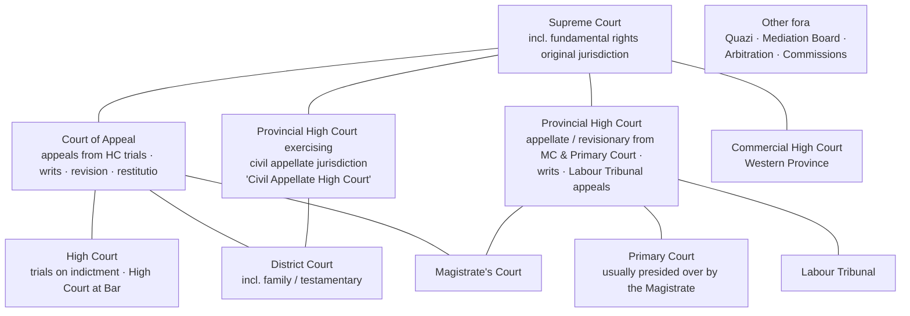
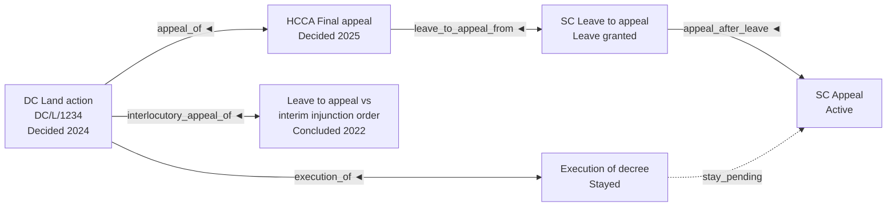

# 05 — Court & Proceeding Model

Covers PART 6 (court structure), PART 7 (proceedings), PART 8 (party roles per proceeding).

> **Everything about specific Sri Lankan courts, case types, case-number formats, stages and time limits in this document is illustrative and [NEEDS LAWYER CONFIRMATION].** The design goal is that all of it lives in **reference data and workflow templates**, editable by an administrator, not in code.

---

## 1. Design goals

1. One data model serves every court and proceeding type; differences come from **templates**.
2. A proceeding's history (case numbers, courts, stages, parties) is **never overwritten**.
3. A matter may contain any number of proceedings, linked in a **graph** (not just a parent/child chain).
4. Court master data is shared across the firm (and, in a multi-firm future, possibly across tenants).

---

## 2. Court structure (reference data)

### 2.1 Hierarchy (illustrative)

Lines indicate common appeal/revision paths only loosely — the real paths depend on the proceeding type and are expressed through **allowed relationship rules** in templates (**[NEEDS LAWYER CONFIRMATION]**). Tribunals, mediation boards and arbitration are included because a "matter" may pass through them before or instead of court (**[NEEDS LAWYER CONFIRMATION]** whether the pilot firm handles these).

**[ASSUMPTION]** In practice the High Court (Judicature Act) and the Provincial High Court (Constitution Art. 154P; High Court of the Provinces (Special Provisions) Act No. 19 of 1990, as amended) often sit in the same courthouse with the same judges, but their jurisdictions, case-number series and appeal routes differ. Model them as **separate court levels** that can share a court location, so reports and relationship rules stay correct. **[NEEDS LAWYER CONFIRMATION]**

### 2.1a Jurisdiction and appeal routes (illustrative, for template design)

| Court level | Typical first-instance work | Typical route onward (and whether leave is needed) |
|---|---|---|
| Magistrate's Court | Criminal summary trials, B reports, bail/remand, maintenance | Appeal/revision → Provincial High Court; revision also → Court of Appeal |
| Primary Court | Land possession disputes (Primary Courts' Procedure Act s.66) | Revision → Provincial High Court |
| District Court | Civil, land, partition, money, family/divorce, testamentary | Final appeal → HCCA; **leave to appeal** against interlocutory orders → HCCA; revision/restitutio → Court of Appeal |
| HCCA | Civil appeals from DC in the province | **Leave to appeal** → Supreme Court |
| Commercial High Court | Commercial disputes above a value threshold, IP, company matters | Appeal → Supreme Court |
| High Court (criminal) | Trials on indictment, High Court at Bar | Appeal → Court of Appeal → **special leave** → Supreme Court |
| Provincial High Court (appellate/writ) | Appeals from MC/Primary Court, writs on provincial matters, Labour Tribunal appeals | Appeal → Supreme Court (**leave** usually required) |
| Labour Tribunal | Termination and other workman applications | Appeal on a question of law → Provincial High Court |
| Court of Appeal | Writs, revision, restitutio, appeals from HC criminal trials, election petitions | **Leave / special leave to appeal** → Supreme Court |
| Supreme Court | Fundamental rights, constitutional matters, final appeals, leave/special leave applications | — |

**[NEEDS LAWYER CONFIRMATION]** every row: leave requirements, time limits, value thresholds and current routes after recent amendments. Leave applications are modelled as **their own proceeding** (`leave_to_appeal_from`), with the appeal itself as a separate linked proceeding once leave is granted (§5).

### 2.2 Court entities

| Concept | Attributes | Example |
|---|---|---|
| **Court level** | Code, names (SI/EN/TA), rank order, typical jurisdiction notes | District Court |
| **Court** (an institution at a place) | Level, official name (SI/EN/TA), judicial zone/district, province, address, map location, registry phone/email, sitting days pattern, active flag | District Court of Colombo; Magistrate's Court of Gampaha |
| **Court division / jurisdiction stream** | Optional sub-unit within a court where case numbering or registry differs | e.g. Commercial division, Family division, Special/Land division (**[NEEDS LAWYER CONFIRMATION]**) |
| **Courtroom / bench** | Court, identifier ("Courtroom 3", "No. 2 Court"), typical judge, floor | |
| **Judge / judicial officer** (optional) | Name (bilingual), court, from–to dates | Captured per hearing only if firm wants it (**[MAKE CONFIGURABLE]**) |
| **Court calendar** | Public holidays, Poya days, court vacations (by court level), special non-sitting days | Used for deadline computation and diary warnings |

**[ASSUMPTION]** The initial court list (all Magistrate's, District, High Courts and appellate courts) can be compiled from public sources and verified by the firm — part of Milestone 1 data preparation.

### 2.3 Why courts are reference data, not text

- Diary grouping ("all cases in Colombo DC tomorrow").
- Weekly travel planning (courts in the same complex vs. outstation).
- Case-number validation per court.
- Future connectors map *our* court IDs to *their* identifiers (doc 15).

---

## 3. Proceeding types and workflow templates

### 3.1 Proceeding type

A **proceeding type** is a template that controls behaviour without separate applications:

| Template element | Example (illustrative) |
|---|---|
| Name (SI/EN) | "Land action (District Court)", "Partition action", "Money recovery", "Divorce", "Testamentary", "B report (MC)", "Summary trial (MC)", "Indictment (HC)", "Civil appeal (HCCA)", "Leave to appeal (HCCA, interlocutory)", "Leave to appeal (SC)", "Special leave to appeal (SC)", "Writ application (CA)", "Writ application (Provincial HC)", "Revision application", "Habeas corpus", "Fundamental rights (SC)", "Commercial action (Commercial HC)", "Labour Tribunal application", "Labour Tribunal appeal (PHC)", "Primary Court s.66 dispute" |
| Case category | Fixed reporting category: Civil · Criminal · Family · Commercial · Land · Writ / public law · Fundamental rights · Labour · Appellate · Other — so "cases by category" reports work across all types |
| Allowed court levels | Writ → Court of Appeal / Provincial HC |
| **Case-number pattern(s)** | Regex + display mask + examples per court/type (e.g. a land case prefix, a "B/1234/26" style MC number). Used to **warn**, never to block — real numbers vary |
| Party role catalogue | Plaintiff/Defendant vs Petitioner/Respondent vs Complainant/Accused |
| Stage catalogue (ordered, with optional branching) | See §3.2 |
| Hearing purpose catalogue | Mention / Call · Answer · Replication · Pre-trial · Trial · Further trial · Inquiry · Support (for leave/notice) · Argument · Written submissions · Judgment · Order · Bail · Remand extension (**[NEEDS LAWYER CONFIRMATION]**) |
| Preparation checklist templates | Per hearing purpose |
| Document checklist | Required/expected documents |
| Deadline rules | e.g. "appeal within N days of judgment, excluding …" — **suggest only, lawyer confirms** |
| Allowed outgoing relationships | Final appeal, leave to appeal, revision, restitutio in integrum, execution… |
| Default confidentiality | e.g. family/criminal = Restricted |

### 3.2 Stages — generic backbone + type-specific detail

Rather than a unique stage list per type with no comparability, use a **two-level stage model**:

| Generic stage (fixed, for reports) | Type-specific stages (configurable examples) |
|---|---|
| `Pre-filing` | Drafting, Awaiting client documents, Mediation board certificate |
| `Filed / Instituted` | Plaint filed, Petition filed, B report filed |
| `Service & appearance` | Summons issued, Summons served, Notice issued, Proxy filed |
| `Pleadings` | Answer, Replication, Amended pleadings, Objections |
| `Pre-trial / Interlocutory` | Pre-trial, Interim injunction inquiry, Bail, Survey/commission |
| `Trial / Inquiry / Argument` | Trial, Further trial, Inquiry, Argument, Support for leave |
| `Submissions` | Written submissions |
| `Judgment / Order reserved` | Judgment reserved |
| `Decided` | Judgment delivered, Decree entered, Acquitted/Convicted, Leave granted/refused |
| `Post-decision` | Execution, Appeal period running, Settlement terms being performed |
| `Concluded` | Final, Withdrawn, Dismissed, Settled, Abated, Transferred out |

Reports and dashboards use the generic stage; lawyers see the specific stage. **[MAKE CONFIGURABLE]** per type; **[NEEDS LAWYER CONFIRMATION]** for the list.

Stage changes are events (who, when, from, to, source hearing) so the stage history is always reconstructable.

---

## 4. Proceeding model (PART 7)

### 4.1 Fields

| Field | Notes |
|---|---|
| Proceeding ID | Internal, immutable |
| Matter | Exactly one owning matter |
| Proceeding type | Template |
| Court (+ division) | Current court |
| **Current case number** | Display value, derived from case-number history |
| Case-number history | List of {number, court, valid from, valid to, reason: assigned / corrected / re-numbered / transferred} |
| Our side | Plaintiff-side / Defendant-side / Petitioner / Respondent / Accused / Complainant / Intervenient / Amicus |
| Our role | e.g. attorney on record; counsel only (another firm holds proxy); watching brief (**[NEEDS LAWYER CONFIRMATION]**) |
| Attorney on record (proxy holder) | Firm lawyer or external; proxy filed date |
| Counsel | Firm or external counsel; history |
| Filed / instituted date | |
| Current stage | Generic + specific |
| Status | `Active` · `Dormant` (e.g. laid by / sine die) · `Concluded` (with outcome) · `Transferred out` |
| Outcome | Judgment for plaintiff, dismissed, settled, withdrawn, acquitted, convicted, leave granted… (configurable) |
| Value of claim (optional) | Civil cases; useful for court-fee/jurisdiction notes and reports (**[MAKE CONFIGURABLE]**) |
| Subject matter tags | Land/property reference, vehicle no., etc. — links to "matter subject" entities for conflict search |
| Opposing attorneys/counsel | Per party (see doc 04 §5) |
| Registry notes | Registry file location, registrar contact |
| Confidentiality override | May be stricter than the matter |

### 4.2 Why case numbers are a history, not a field

- A newly filed case may have no number for days/weeks ("to be assigned").
- Numbers are occasionally corrected or reformatted.
- Transfers between courts produce a new number at the receiving court; the old number remains essential for finding old documents and journal entries.
- Search must find a proceeding by **any** number it ever had.

Uniqueness: `(court, normalised case number)` should be unique across the firm. A duplicate triggers a **warning** with the existing matter (the firm may legitimately act for two parties in consolidated cases, or the same case may have been entered twice by mistake). **[NEEDS LAWYER CONFIRMATION]**.

---

## 5. Proceeding relationships

A proceeding may relate to any other proceeding in the same matter (and, by explicit cross-matter link, in another matter).

| Relationship type | From → To | Example |
|---|---|---|
| `appeal_of` | Appeal → decision appealed | HCCA appeal of DC judgment |
| `leave_to_appeal_from` | Leave application → decision | SC leave to appeal from HCCA judgment |
| `appeal_after_leave` | Appeal → leave application | SC Appeal after leave granted |
| `interlocutory_appeal_of` | Appeal → interlocutory order in an ongoing case | Leave to appeal against an interim order while trial continues |
| `revision_of` | Revision application → order | CA revision of MC order |
| `restitutio_of` | Restitutio in integrum → decision | |
| `writ_against` | Writ application → administrative decision (may not be a court proceeding) | Link to an "external decision" record |
| `transferred_from` | New proceeding → original | Transfer between courts |
| `remitted_retrial` | Proceeding (resumed or new) → appellate order sending it back | **[NEEDS LAWYER CONFIRMATION]** whether retrial reuses the old number |
| `execution_of` | Execution proceeding → decree | |
| `consolidated_with` | Symmetric | Two actions heard together |
| `committed_from` | Indictment proceeding → MC proceeding it arose from | B report / non-summary inquiry leading to an HC indictment (**[NEEDS LAWYER CONFIRMATION]**) |
| `connected_with` | Symmetric, generic | Criminal case connected to a civil case on the same facts |
| `stay_pending` | Proceeding → proceeding whose outcome it awaits | Execution stayed pending appeal |

Rules:
- Relationship types are **[MAKE CONFIGURABLE]**, with allowed from/to proceeding-type pairs.
- An appeal **never modifies** the original proceeding; the original's status may change (e.g. "Decided — under appeal") through an event.
- Relationship graph is shown as a tree/graph on the matter page ("Proceedings map").
- The **original proceeding** is not a stored flag. It is derived as the proceeding at the root of the graph (no outgoing `appeal_of` / `revision_of` / `transferred_from` / `committed_from` link). A matter may have more than one root, e.g. a civil action and a connected criminal case.

---

## 6. Transfers and moving between courts

| Scenario | Handling |
|---|---|
| Case transferred to another court (same proceeding continues) | **[NEEDS LAWYER CONFIRMATION]** Option A: same proceeding, new court + new case number appended to history. Option B: new proceeding linked `transferred_from`. **Recommendation:** Option A when it is the same action continuing; Option B when it becomes a different action type |
| Original court's judgment appealed | New proceeding (`appeal_of`); original concluded or "under appeal" |
| Appellate court remits for retrial | Original proceeding resumes (stage reset event) or new linked proceeding — configurable |
| B report becomes indictment in HC | New proceeding linked `committed_from` (**[NEEDS LAWYER CONFIRMATION]**) |

Historical references preserved in all cases: old court, old number, old hearings, old documents all remain attached and searchable.

---

## 7. Parties per proceeding

See doc 04 §5. Key points restated for the proceeding model:

- Party roles are **per proceeding**; when an appeal is created, the system **proposes** parties and transformed roles from the original (Plaintiff → Plaintiff-Respondent/Appellant), which the user confirms.
- Party ordinal ("1st Defendant") is preserved because court lists and journals refer to it.
- Substitutions (death, assignment) are events with dates; the substituted party remains in history.
- Adding a party triggers an incremental conflict check.

---

## 8. Workflow configuration summary for courts/proceedings

| Configurable item | Owner | Versioned? |
|---|---|---|
| Court levels, courts, divisions, courtrooms | Admin | Yes (effective dates) |
| Court calendar (holidays, vacations) | Admin | Yearly |
| Proceeding types | Admin + senior lawyer | Yes — templates versioned; existing proceedings keep their version unless migrated |
| Case-number patterns | Admin | Yes |
| Party role catalogue | Admin | Yes |
| Stage catalogue + mapping to generic stages | Admin + senior lawyer | Yes |
| Hearing purposes, outcome types | Admin + senior lawyer | Yes |
| Relationship types and allowed pairs | Admin | Yes |
| Deadline rules | Senior lawyer (approved) | Yes; always "suggested", never auto-binding |

**Configuration is data, not a scripting language.** Avoid a general workflow engine in MVP; templates are declarative lists and rules evaluated by simple code. A BPMN-style engine is explicitly **out of scope** unless the pilot proves it necessary.
