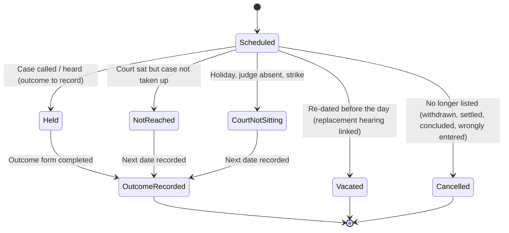

# 06 — Hearing Workflow & Court Diary

Covers PART 9 (hearing management), PART 10 (lawyer daily work), PART 11 (weekly planning). Court-day mobile mode is in doc 12.

> Hearing management is the heart of NithiDesk. A missed or wrongly recorded date is the single most damaging failure the product can cause (doc 19, risk R1).

---

## 1. Definitions

| Term | Meaning |
|---|---|
| **Hearing** (listing) | One scheduled occasion on which a proceeding is listed before a court on a date. Includes short "call/mention" dates, not only full trials. |
| **Date assertion** | A claim that the hearing is on a particular date/time, from a particular source, recorded by a particular person at a particular time. A hearing can have several over its life. |
| **Verification** | A person with authority confirms the current date against an **authoritative source** (case record/journal, certified order, official court list, official connector). |
| **Outcome** | What actually happened at the hearing (recorded after the event). |
| **Next hearing** | A new hearing record created from the outcome, linked to the previous one. |

**[NEEDS LAWYER CONFIRMATION]** terminology the firm uses: "calling date", "mention", "date of trial", "next date", "JE".

---

## 2. What is recorded for each hearing

| Field | Notes |
|---|---|
| Proceeding | Mandatory (and therefore matter and court) |
| Court / courtroom | Defaults from proceeding; courtroom may vary per hearing |
| **Date** (local, Asia/Colombo) | Stored as a *local date*, not a UTC timestamp — a court date must never shift because of timezone conversion |
| Time / session | Optional time; or session = Morning / Afternoon / Not specified. **[ASSUMPTION]** many listings have no specific time |
| Purpose | From the proceeding type's purpose catalogue + free text ("Trial — PW1 cross-examination") |
| Appearing lawyer(s) | Who will appear (may differ from lead lawyer); external counsel possible |
| Instructing attorney present | If counsel appears, who instructs (**[NEEDS LAWYER CONFIRMATION]**) |
| Assigned clerk | Responsible for verification and registry work |
| Judge (optional) | Who is presiding, if the firm records it (**[MAKE CONFIGURABLE]**, doc 05 §2.2) |
| Previous hearing | Link (automatic when created from an outcome) |
| Previous outcome summary | Derived from previous hearing |
| Preparation status | `Not started` · `In progress` · `Ready` · `Blocked` (reason) |
| Preparation checklist | From template (§5) |
| Documents needed | Links to documents + "required but missing" placeholders |
| Witnesses | Links to party/witness entities + summons status / contacted flag |
| Instructions / brief note | Senior's instructions to the appearing lawyer ("Seek date to file objections; do not consent to amendment") |
| Notes | Internal |
| **Date assertions** (history) | See §3 |
| **Verification state** | See §4 |
| **Lifecycle status** | See §4 |
| Outcome | See §6.4 |
| Next hearing | Link |
| Source import reference | If created by import / connector |

---

## 3. Date provenance — where a date came from

Every date assertion records:

| Attribute | Values / notes |
|---|---|
| Source type | `Court order at previous hearing` (announced in court) · `Case record / journal entry` · `Certified copy of order` · `Official court list / cause list` · `Registry (in person)` · `Registry (phone)` · `Notice / summons from court` · `Government digital service` (connector) · `Lawyer entry` · `Clerk entry` · `Email` · `Letter / document` · `Opposing counsel` · `Client` · `Migrated from diary / spreadsheet` |
| Source detail | Journal entry number/date, court list date, document link, connector reference, free text |
| Source authority | Derived from type: **Authoritative** (case record, certified order, official list, official connector) · **Primary** (announced in open court and recorded by the appearing lawyer) · **Secondary** (registry phone, notice copy, email) · **Hearsay** (opposing counsel, client, migrated data) — mapping is **[MAKE CONFIGURABLE]** |
| Asserted by / at | User and timestamp |
| Evidence | Optional photo/scan (court list photo, journal photo where permitted — **[NEEDS LAWYER CONFIRMATION]**) |

Rules:
- Assertions are **append-only**. Changing a date never deletes the previous assertion.
- If a new assertion disagrees with the current *verified* date, the hearing enters **Conflict** (see §4) — it does not silently overwrite.
- **Correction vs re-dating.** A new assertion on the *same* hearing means "we disagree about what the court fixed for this listing" (a mis-recorded date, a journal that differs from the lawyer's note). When the court or registry actually **moves** the listing before the day (motion to advance or postpone, notice that the court will not sit), the hearing becomes `Vacated` and a **replacement hearing** is created with its own assertions (§4.2). The UI asks which one it is: "The date was recorded wrongly" or "The court changed the date".

---

## 4. Statuses — challenged and recommended

### 4.1 The problem with the proposed list

Proposed: Unverified, Verification required, Verified, Changed, Postponed, Cancelled, Completed.

These mix **two independent questions**:
1. *How sure are we of the date?* (Unverified / Verification required / Verified)
2. *What is happening to the listing?* (Postponed / Cancelled / Completed)

…plus one that is **an event, not a state** ("Changed").

A hearing can be *Verified* **and** *Postponed*, or *Completed* **and** have its *next* date unverified. A single status field cannot express that, and users will pick whichever feels most urgent, destroying the meaning.

"Postponed" is also ambiguous in Sri Lankan practice:
- the court sits, the case is called and the court **adjourns** it to a new date → the hearing **took place** (outcome: adjourned) and a *new* hearing exists;
- the case is **re-dated before the day** (court not sitting, judge on leave, motion to advance/postpone, notice from registry) → the hearing **did not take place**; it was *vacated* and replaced.

These must be distinguishable because the first produces a court order/journal entry and the second may not.

### 4.2 Recommended model — two dimensions + events

**Dimension A — Listing status (lifecycle):**



- `Held`, `Not reached`, `Court not sitting` are all *past* states that still require the next date — the "outcome pending" queue catches any hearing in the past without a recorded outcome.
- `Outcome recorded` requires **either** a next hearing **or** an explicit reason there is none: proceeding concluded (judgment, dismissal, settlement, withdrawal), laid by / sine die (proceeding becomes Dormant, §8), or "date to be obtained from registry" (which creates an urgent clerk task). A hearing can never close silently with no next step.
- `Vacated` always links to its replacement hearing (or reason if none).
- `Cancelled` requires a reason.
- "Completed" from the brief = `Outcome recorded`.
- "Postponed" from the brief = either `Held` with outcome *Adjourned* (+ next hearing) or `Vacated` (+ replacement). The UI offers both as plain-language buttons ("Court gave a new date" / "Date changed before the hearing").

**Dimension B — Date verification state (confidence):**

| State | Meaning | Visual (never colour alone) |
|---|---|---|
| `Unverified` | Only hearsay/secondary/primary assertions; not yet confirmed from an authoritative source | Dashed outline, **"?" icon**, label "Not verified", amber |
| `Verified` | An authorised person confirmed the current date against an authoritative source | Solid, **✓ icon**, label "Verified · by K. Silva · JE 24 · 12/10" |
| `Conflict` | Two or more current assertions disagree, or a new assertion contradicts a verified date | **⚠ icon**, label "Dates disagree", red, pinned to top of every view |
| `Verification overdue` (derived) | Unverified and within the configured window (e.g. ≤ 3 working days away) | Unverified styling + "Overdue" badge; escalates notifications |

"Verification required" from the brief becomes the derived **Verification overdue** flag — it is a deadline condition, not a state someone sets.

**Events (timeline/audit, not statuses):** Date asserted · Date changed · Verified · Verification revoked · Conflict raised · Conflict resolved · Re-dated · Appearing lawyer changed · Outcome recorded · Outcome corrected.

### 4.3 Verification rules

| Rule | Default | Config |
|---|---|---|
| Who may verify | Clerks, lawyers on the matter, partners | **[MAKE CONFIGURABLE]** |
| Does a date announced in court and recorded by the appearing lawyer count as Verified? | **No by default** — it is *Primary*; the clerk confirms from the journal. Rationale: transcription errors on phones in a busy corridor are the commonest failure | **[MAKE CONFIGURABLE]** / **[NEEDS LAWYER CONFIRMATION]** — some firms will trust the appearing lawyer |
| Verification window | Must be verified ≥ 2 working days before the hearing | Configurable per court/priority |
| Re-verification | If a verified date is older than X days and the hearing is soon, prompt a re-check against the court list | Optional |
| Verification evidence | Source detail mandatory (JE no. / court list date); photo optional | Configurable |
| Changing a verified date | Creates a new assertion; state becomes `Conflict` until someone verifies the new date — **no silent overwrite**, even for partners | Fixed rule |
| AI or connector | Connector data from an official service may auto-set `Verified` **only** if firm policy enables it for that connector; AI never verifies | doc 14, doc 15 |

### 4.4 Court-list check (daily routine)

1. Clerk obtains the day's or next day's court list (paper, photo, PDF, website, later connector).
2. Clerk enters/imports the case numbers on the list (Phase 1: manual tick-off against "our hearings at this court tomorrow"; Phase 2: CSV/PDF import with matching).
3. System matches by court + normalised case number:
   - **On list & our hearing exists** → confirmation (may verify).
   - **Our hearing exists but not on list** → ⚠ alert ("not listed — check registry").
   - **On list but no hearing in NithiDesk** → ⚠ alert ("unexpected listing — possible missed date").
   - **On list for a date different from our recorded date** → adds an *Official court list* assertion, so the hearing goes into `Conflict`.
   - Proceedings with **no case number yet** cannot be matched; they are shown separately so the clerk can check them by party name.
4. Results stored as an import batch for audit.

This single routine is likely to be the most valuable risk control in the product. **[NEEDS LAWYER CONFIRMATION]** how court lists are published and obtained per court.

---

## 5. Hearing preparation

### 5.1 Checklist templates (per hearing purpose × proceeding type — [MAKE CONFIGURABLE])

Example items: Court date verified (auto-ticked from verification state) · Client contacted and confirmed attendance · Previous order/journal reviewed · Brief reviewed by appearing lawyer · Required documents prepared · Originals available (from originals register) · Copies for court & opposing party · Witnesses contacted / summons served · Interpreter arranged · Court fees / stamps ready · Transport / outstation travel arranged · Counsel briefed (fee/brief sent).

### 5.2 Preparation status logic

- `Ready` requires all *mandatory* checklist items done (or waived with reason).
- `Blocked` with reason (missing document, client unreachable).
- T-2 working days and not Ready → notify lead lawyer; T-1 → notify responsible partner for high-priority matters.

---

## 6. Lawyer's daily view — "Today" (PART 10)

### 6.1 Questions it must answer at a glance

| Question | Shown as |
|---|---|
| What cases do I have today? | Ordered list of my hearings (by court, then time/session) |
| Which courts? | Grouped by court with address/map link; travel order |
| Case number? | Prominent, copyable, with previous numbers on tap |
| Client? | Client name (preferred script + other script below) |
| Opposing party? | Main opposing party ("v. Silva and 3 others") |
| What happened last time? | One-line previous outcome + previous order excerpt |
| Today's purpose? | Purpose + senior's instructions highlighted |
| Documents needed? | Count + list; "2 missing" in red with icon |
| Anything missing? | Badges: unverified date, missing docs, not Ready, client not contacted |
| What after court? | "Record outcome" button; outstanding post-court tasks from earlier |

### 6.2 Layout concept (desktop)

```
┌ Today · Monday 12 October 2026 ──────────────────────────────────────────────┐
│ ⚠ 1 date conflict   ? 2 unverified   ⏰ 3 tasks due   ✎ 1 outcome not recorded │
├──────────────────────────────────────────────────────────────────────────────┤
│ COLOMBO DISTRICT COURT · Hulftsdorp            (3 hearings)                  │
│  ✓ DC/L/1234 · Perera v. Silva (+3) · Trial – PW1 cross · Room 5 · Ready     │
│     Last: Adjourned; plaintiff to tender documents marked P5–P9              │
│     Docs 6/6 · Instruction: "Object to P9 – unstamped"   [Open] [Brief]      │
│  ? DC/DMR/556 · ABC (Pvt) Ltd v. Fernando · Answer · Not verified · Blocked  │
│     Missing: Answer draft not approved                                        │
│ MAGISTRATE'S COURT · Colombo Fort                (1 hearing)                 │
│  ✓ B/1234/26 · Police v. Jayasinghe (our client: suspect) · Bail · Ready     │
├──────────────────────────────────────────────────────────────────────────────┤
│ After court: record outcomes (4) · Tasks due today (3) · Tomorrow: 5 hearings │
└──────────────────────────────────────────────────────────────────────────────┘
```

(Illustrative case numbers.) Mobile version, including the court-day case card, quick outcome form, read-back confirmation and "request client contact": doc 12 §3. This document defines the *data* those screens use; doc 12 defines the mobile *interaction*.

### 6.3 Daily brief

Generated each morning (default 6:00 a.m. Asia/Colombo, **[MAKE CONFIGURABLE]**) for every user with appearances: the Today view as an in-app digest; email in Phase 1-late; printable PDF (bilingual) on request — some lawyers will still want paper in court.

### 6.4 Outcome recording (after court)

| Field | Notes |
|---|---|
| What happened | Outcome type: Adjourned · Step completed (answer filed etc.) · Evidence led · Argued · Order made · Judgment delivered · Settled · Withdrawn · Not reached · Court not sitting · Bail granted/refused · Remand extended… (**[MAKE CONFIGURABLE]**) |
| Order / direction (text) | Free text, bilingual; optional photo |
| **Next date** | Date + session/time + purpose → creates linked next hearing with source = "Court order at hearing on [date]", authority = Primary, state = Unverified (default) |
| Stage change | Suggest based on outcome type |
| Who must do what | Quick tasks: e.g. "File list of witnesses — due 15 days before next date" |
| Client to be informed? | Default yes → creates client-update task |
| Certified copy needed? | → task for clerk |
| Internal notes | Not client-visible |
| Who appeared | Defaults to assigned; edit if someone else covered |

Outcome edits after submission create a correction event (original preserved).

---

## 7. Weekly planning view (PART 11)

Audience: lead lawyers, partners, clerks (Friday/Monday planning).

### 7.1 Content

Upcoming 7 (or 14) days, grouped by **day → court** (default) or **lawyer** or **matter**, showing per hearing: lawyer, court, case, purpose, preparation status, missing documents, verification state, overdue tasks on that matter.

### 7.2 Highlights (sorted to the top)

1. **Date conflicts** (⚠)
2. **Unverified dates** inside verification window
3. **Schedule clashes** — same lawyer listed in two courts in the same session; hearings at courts too far apart for the same morning (uses court location; travel threshold **[MAKE CONFIGURABLE]**); a lawyer on leave with appearances
4. **Not Ready** preparation for high-priority hearings
5. **Missing documents**
6. **Overdue tasks** on matters with a hearing this week
7. **Client updates pending** from last week's outcomes
8. **Outcome not recorded** for past hearings (should be zero)

### 7.3 Actions from the weekly view

Reassign appearing lawyer (with automatic access grant if needed — doc 09 appearance-scoped access) · Request verification · Brief external counsel · Open matter.

### 7.4 Calendars

Day / week / month calendars filterable by lawyer, court, case type, status, verification state, location. iCal **read-only feed** of a user's *own* appearances (no client names in feed by default — confidentiality) — Phase 2.

---

## 8. Edge cases

| Case | Handling |
|---|---|
| Two proceedings of the same matter listed the same day | Shown separately; grouped under matter on mobile |
| Many matters at one court, same lawyer | Grouped by court; order editable |
| Hearing for a case where firm only "watches" | Shown with "watching brief" badge |
| Court declares sudden holiday | Bulk action: "Court not sitting today" for all hearings at that court; prompts for next dates |
| Lawyer enters a date in the past by mistake | Validation warning; allowed for backfilling with reason |
| Date given as "to be fixed" / "sine die" | Proceeding marked Dormant; no hearing; reminder task to check the record periodically |
| Date-only vs time: DST/timezone | Not applicable in Sri Lanka, but local-date storage avoids server-timezone bugs |
| Clerk verifies, then lawyer edits | Conflict state; both notified |
| Newly filed case, no case number yet | Hearing allowed (keyed to proceeding, not number); shown with "No case no." badge; excluded from court-list matching (§4.4) |
| Appearing lawyer changes on the day (junior covers) | Outcome form's "Who appeared" records the actual person; appearance-scoped access granted (doc 09 §2.2) |
