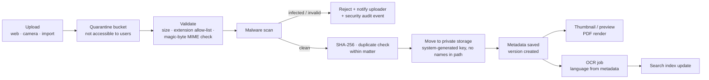

# 07 — Document Workflow

Covers PART 13 (document management), PART 14 (document search), PART 20 (global search), and evidence.

---

## 1. Principles

1. **Documents belong to a Matter**, and are *linked* (many-to-many) to proceedings, hearings, tasks, parties, communications and evidence items. Folder trees are a *view*, not the storage model.
2. **Never silently overwrite.** Every change is a new version; the filed/served version is pinned.
3. **The digital copy is not the original.** Physical originals (deeds, signed affidavits, certified copies) are tracked in an **originals register**.
4. **Confidentiality is per document**, defaulting from matter, never weaker than the matter.
5. **Mixed Sinhala/English is normal** — titles, OCR, search must handle both.

---

## 2. Document categories (PART 13)

Two-level taxonomy, **[MAKE CONFIGURABLE]**, bilingual labels:

| Group | Categories (examples) | Default confidentiality | Typical links |
|---|---|---|---|
| Client documents | Identity documents, deeds, title documents, survey plans, agreements, company documents, financial records, medical records | Restricted for ID/medical | Matter, client |
| Pleadings & filings | Plaint, answer, replication, petition, statement of objections, motion, affidavit, list of witnesses/documents, written submissions, petition of appeal, notice of appeal, leave application, proxy | Standard | Proceeding, hearing |
| Court-issued | Summons, notice, journal extract, order, interim order, judgment, decree, certified copy of proceedings, court list | Standard | Proceeding, hearing |
| Evidence | Marked documents (P1/D1 etc.), photographs, audio/video, expert reports, police documents (B report, statements, information book extracts — **[NEEDS LAWYER CONFIRMATION]** what is lawfully obtained), medical-legal reports | Restricted | Evidence item, proceeding |
| Correspondence | Letters to/from client, letters to/from opposing counsel, letters to/from registry/authorities, emails (filed), WhatsApp exports | Standard | Communication, matter |
| Agreements & transactional | Contracts, settlement agreements, deeds of transfer, leases (conveyancing matters) | Standard | Matter |
| Internal | Internal notes, legal research, draft opinions, strategy memos, counsel's opinion | **Privileged-internal** (never client-visible, never external counsel unless shared) | Matter |
| Finance (Phase 2) | Fee notes, receipts, court fee receipts | Finance-only | Matter |
| Other | Anything else (must still pick a group) | Standard | |

---

## 3. Document record

| Field | Notes |
|---|---|
| Document ID | Internal |
| Matter | Mandatory (except firm-wide templates/precedents library — separate area) |
| Links | Proceeding(s), hearing(s), task(s), evidence item(s), parties, communication |
| Display title (SI/EN) | User-editable; defaults from filename + category |
| Category (group + type) | Mandatory |
| Document date | Date *on* the document (e.g. judgment date), distinct from upload date |
| Language(s) | Sinhala / English / Tamil / mixed — drives OCR language selection |
| Author / source | Our firm, client, opposing party, court, police, third party |
| Status | Draft · Final · **Filed** (with filing date + court stamp scan) · Served · Superseded · Withdrawn |
| Confidentiality | Standard · Restricted · Privileged-internal · Highly restricted (named users only) |
| Client-visible flag | Default off (portal/secure-link sharing) |
| Key document flag | Shows on timeline, court-day pack, brief |
| Versions | See §4 |
| Original filename, MIME type, size, SHA-256 per version | Integrity & dedup |
| Uploaded by / at; source channel | Web, mobile camera, email-in (later), import, connector |
| Processing status | Quarantined → Scanned clean / Rejected → OCR pending/done/failed → Indexed |
| OCR text + confidence | Per page where available; language detected |
| Page count | |
| Retention class | Inherited from matter category; overridable by authorised user |
| Legal hold | Inherited from matter/proceeding hold or set on the document |
| Original held? | Link to originals register entry |

---

## 4. Versioning

- A **document** is the logical item ("Answer of the 1st Defendant"); **versions** are files.
- Upload a new version → previous versions retained, immutable, with who/when/why.
- One version may be marked **Filed** (or Served) — that version is pinned and highlighted; further edits create new versions without un-filing it.
- Drafting workflow (Phase 2): draft → review (task with reviewer) → approved → filed.
- Deletion: soft-delete only, by authorised roles, with reason; physical purge only through the retention/disposal workflow and never under legal hold. Purge is audited with hash retained.
- **[ASSUMPTION]** No in-browser editing of Word files in MVP — users download, edit in Word, upload new version. Office/Google integration is Phase 3+.

---

## 5. Evidence

Evidence is more than a document: it may be physical, has a marking, a chain of custody and a status in court.

| Evidence item field | Notes |
|---|---|
| Proceeding | Evidence is per proceeding |
| Description (SI/EN) | |
| Type | Document · Physical object · Photograph · Audio/video · Digital (device, messages) · Expert report |
| Marking | "P1", "D3", "X", "V1" — as marked in court (**[NEEDS LAWYER CONFIRMATION]** conventions) |
| Tendered by | Party |
| Status | Identified · Listed (in list of documents) · Marked · Admitted · Objected · Rejected · Returned |
| Linked documents | Digital copies/scans |
| Physical custody | Where it is: firm safe, client, court productions, police — with custody log (who, when, from, to) |
| Hash / integrity | For digital evidence: SHA-256 at receipt, preserved |
| Hearing marked at | Link |

Evidence and its digital files are **never** altered; corrections are new records. Highly sensitive (e.g. photographs of victims) → Highly restricted.

---

## 6. Upload & processing pipeline



| Control | Detail |
|---|---|
| Allowed types | PDF, images (JPG/PNG/HEIC→converted), DOC/DOCX, XLS/XLSX, ODT, TXT, EML/MSG, audio/video (configurable size cap). Executables, scripts, archives with executables blocked. Macros: DOCM/XLSM blocked or quarantined for review (**[MAKE CONFIGURABLE]**) |
| Max size | e.g. 100 MB default; video larger by role (**[MAKE CONFIGURABLE]**) |
| Storage | S3-compatible private storage; object key = random ID; no client names in paths; encryption at rest |
| Access | Via API authorisation check → short-lived signed URL (e.g. 60–300 s) or streamed through API; never public URLs |
| Previews | Server-side rendered previews (PDF/image) so users can *view* without *downloading* — downloads separately permissioned |
| Camera capture | Mobile: multi-page photo → auto-crop → single PDF; marked "photo capture" source |
| Duplicates | Same hash within a matter → warn and link instead of storing again |

OCR: see doc 11 §7 for Sinhala OCR options. OCR output is stored separately from the original and never replaces it.

---

## 7. Retention & legal hold

| Concept | Design |
|---|---|
| Retention class | Per matter category / document category: e.g. "Litigation — keep N years after closure" (**[NEEDS LAWYER CONFIRMATION]** periods; professional and statutory guidance) |
| Retention clock | Starts at matter closure (default) |
| Disposal | Report of eligible items → partner approval → purge → disposal certificate (what, when, who, hash) |
| Legal hold | Applied to client / matter / proceeding / document with reason, issuer, date; blocks any deletion or disposal; overrides client deletion requests; visible badge |
| Client data requests (PDPA) | Access/correction supported; erasure **checked against** professional retention and legal hold before any action — never automatic (**[NEEDS LAWYER CONFIRMATION]**) |
| Conflict residue | After disposal, keep minimal entity + matter summary for conflict checking (**[NEEDS LAWYER CONFIRMATION]** legality and period) |

---

## 8. Document search (PART 14)

### 8.1 Filters (structured)

Matter number · case number (any historical number) · client · party · document category · document date range · upload date · court · proceeding · hearing · lawyer (uploader / matter team) · status (filed/draft) · language · confidentiality · has original · key document.

### 8.2 Search levels

| Level | What | Technology direction | Phase |
|---|---|---|---|
| 1. Exact | Matter no., case no. (normalised), document ID, hash | Indexed columns; normalised case-number keys | MVP |
| 2. Metadata & title | Titles, categories, parties, notes; Sinhala and English | PostgreSQL full-text + **trigram** similarity on normalised text (doc 11) | MVP |
| 3. Full-text content | Text in born-digital PDFs/DOCX | Text extraction → PostgreSQL FTS (simple dictionary + custom Sinhala normalisation) | MVP-late / Phase 2 |
| 4. OCR content | Scanned documents (most court documents) | OCR → same index, with OCR-confidence indicator | Phase 2 |
| 5. Cross-script / transliteration | Query "Perera" finds "පෙරේරා" and vice versa | Transliteration keys generated at index time for names and titles; query expansion | Phase 2 (names in MVP for conflict/global search) |
| 6. Semantic | "Affidavits mentioning the boundary dispute at Kotte" | Embeddings (pgvector), permission-filtered, via AI gateway | Phase 3 |

### 8.3 Permission-aware search (non-negotiable)

- Every search query is filtered by the user's accessible matters **inside the database query**, not after retrieval.
- Search result snippets never reveal content from documents the user cannot open.
- Semantic/AI search retrieves only from the user's permitted set (doc 14).
- Searches are logged (query text stored for security audit with retention limit — **[MAKE CONFIGURABLE]**).

### 8.4 Sinhala-specific search behaviour

- Normalise both index and query (NFC, ZWJ/ZWNJ handling, vowel-sign variants, common legacy-encoding artefacts).
- Sinhala has no reliable open stemmer — **[ASSUMPTION]** use normalised token + trigram matching rather than stemming in MVP; evaluate a Sinhala stemmer/lemmatiser later.
- Mixed queries ("Perera land ඔප්පුව") are split by script and both parts applied.

---

## 9. Global search (PART 20)

### 9.1 Behaviour

A single search box (keyboard shortcut `/` on desktop; prominent on mobile) that recognises query shapes:

| Query looks like | Interpreted as | Example |
|---|---|---|
| Case-number pattern | Proceeding (current or historical number) | `B/1234/26`, `DC/L/1234` |
| Matter number | Matter | `ND-2026-0142` |
| NIC (old/new format) | Entity by NIC (exact; result shown only to roles allowed to search by NIC) | `199012345678`, `901234567V` |
| Phone number | Entity by phone (normalised +94) | `0771234567` |
| Sinhala text | Names (Sinhala + transliteration), titles, notes, document text | `පෙරේරා` |
| Latin text | Names (Latin + transliteration to Sinhala), titles, notes, document text | `Nimal Perera` |

### 9.2 Grouped results

```
Search: "perera kotte"
 Matters (3)        ND-2026-0142 Perera v. Silva — land at Kotte  · Open · Next: 14/10 ✓
 Proceedings (4)    DC/L/1234 (Colombo DC) · HCCA/... · SC/LA/...
 Clients (2)        Nimal Perera / නිමල් පෙරේරා · NIC ••••5678
 Parties (5)        K. Perera (1st Defendant, DC/L/9876) ...
 Hearings (2)       14/10 DC/L/1234 Trial ✓ · 21/10 ...
 Documents (12)     Deed No. 4521 (Kotte) · Plaint · Judgment 2024 ...
 Tasks (1)
```

- Each group shows top N with "see all".
- Restricted matters the user cannot access are **not shown at all** (not even "1 hidden result") — except in conflict search, which has its own controlled disclosure (doc 04 §3.4).
- Recent items and "my matters" are boosted.
- Mobile: same grouping, vertically stacked, with case-number results first.
