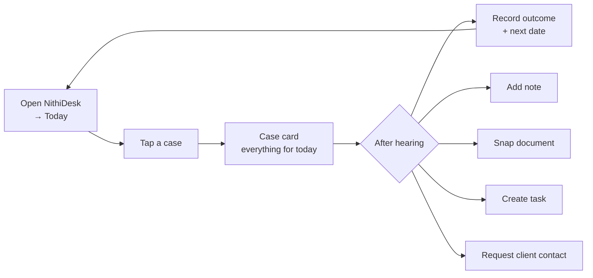

# 12 — Mobile, Court-Day Mode, Offline, Navigation & Dashboards

Covers PART 12 (court-day mode), PART 24 (mobile), PART 25 (offline), PART 32 (navigation), PART 33 (dashboards).

> Wireframes here are **concept sketches for discussion**, not screen designs. Visual design comes after lawyer review.

---

## 1. Mobile design principles

1. **Designed for the corridor, not shrunk from the desk.** One hand, standing, interrupted, poor signal, bright sunlight.
2. **Two taps to any of today's cases.** Today → case.
3. **Read first, write little.** Most court-day actions are reading; writing is quick structured capture.
4. **Big targets, high contrast, status icons + words** (never colour alone).
5. **Silent by default during court hours** — no sounds; badges only (**[MAKE CONFIGURABLE]**). Web push arrives in Phase 2 (doc 17). Until then, mobile alerts are in-app plus email.
6. **Lightweight**: initial load small; works on mid-range Android phones on 3G/4G. **[ASSUMPTION]** most lawyers use Android; iOS must still work well.
7. **Sinhala-first capable**: long Sinhala labels wrap cleanly.

---

## 2. Mobile function support (PART 24)

| Function | Mobile support | Notes |
|---|---|---|
| Today's hearings | **Full (primary)** | Home screen for lawyers |
| Court-day case view | **Full (primary)** | §3 |
| Record outcome + next date | **Full (primary)** | ≤ 60 seconds target |
| Global search (case no., name, Sinhala, phone) | **Full** | Case-number keypad-friendly |
| Document viewing | **Full (preview)** | Server-rendered previews; pinch-zoom; key documents first |
| Photo capture → document | **Full** | Multi-page scan to PDF |
| Notes | **Full** | Text; voice-to-text via OS keyboard dictation (Sinhala dictation support varies — **[ASSUMPTION]**) |
| Tasks (mine, create, complete) | **Full** | |
| Verification queue (clerks) | **Full** | Court-list check-off |
| Weekly planner | Read-only, simplified | Full planning on desktop |
| Conflict decision approval | Approve/decline with reason | Review of complex matches better on desktop |
| Client update approval | Full | |
| Matter creation / onboarding | Limited (quick enquiry capture only) | Full onboarding on desktop |
| Reports, admin, configuration | Not supported | Desktop |
| Document upload from files | Supported | |
| Bulk operations | Not supported | Desktop |

---

## 3. Court-day mode (PART 12)

### 3.1 Flow



### 3.2 Today (mobile) — concept

```
┌───────────────────────────────┐
│ Today · Mon 12 Oct      🔍  ☰ │
│ ⚠1  ?2  ✎1 not recorded        │
├───────────────────────────────┤
│ COLOMBO DC · Hulftsdorp   🗺   │
│ ┌───────────────────────────┐ │
│ │ ✓ DC/L/1234     Room 5    │ │
│ │ Perera v. Silva (+3)      │ │
│ │ Trial · PW1 cross         │ │
│ │ Ready · Docs 6/6          │ │
│ └───────────────────────────┘ │
│ ┌───────────────────────────┐ │
│ │ ? DC/DMR/556  NOT VERIFIED│ │
│ │ ABC (Pvt) Ltd v. Fernando │ │
│ │ Answer · ⛔ Blocked        │ │
│ └───────────────────────────┘ │
│ MC COLOMBO FORT           🗺   │
│ ┌───────────────────────────┐ │
│ │ ✓ B/1234/26   Bail        │ │
│ └───────────────────────────┘ │
├───────────────────────────────┤
│ [Today] [Search] [Tasks] [More]│
└───────────────────────────────┘
```

### 3.3 Case card (court-day view) — what is immediately visible

Order of information (top = most important), all on one scrollable screen, no tabs needed for the essentials:

1. **Header:** case number (large, copyable) · court · courtroom · verification badge · time/session.
2. **Today's objective:** purpose + senior's instructions (highlighted).
3. **Client and parties:** our client by name, with side and role (e.g. "Client: K. Perera — 1st Defendant") · opposing party(ies) · opposing counsel.
4. **Current status:** proceeding stage (specific + generic) · today's listing status · matter attention flags (e.g. "client unreachable", "fees outstanding" if billing is enabled).
5. **Last hearing:** date, outcome, order/direction text (expand for full).
6. **Key documents** (flagged for this hearing): tap to preview; missing ones shown as red placeholders.
7. **Key evidence** (marked items with status).
8. **Notes** (recent, pinned first).
9. **Open tasks** for this proceeding.
10. **Previous case numbers / related proceedings** (collapsed).
11. **Client contact** (tap to call/WhatsApp — via the phone's apps; logged as a communication prompt afterwards).

Sticky bottom action bar: **[Record outcome]** **[Note]** **[📷]** **[Task]** **[⋯]** (⋯ = request client contact, upload from files, mark document required, flag issue).

Every PART 12 quick action is one tap from the case card: record outcome and next date (one form, §3.4) · add note · upload document (📷 camera, or ⋯ → from files) · create task · request client contact (§3.5).

### 3.4 Record outcome — quick form

```
┌───────────────────────────────┐
│ Outcome · DC/L/1234           │
│ What happened?                │
│ (•) Adjourned  ( ) Step done  │
│ ( ) Evidence led ( ) Order    │
│ ( ) Not reached ( ) No sitting│
│ ( ) Settled ( ) Judgment  ⋯   │
│ Direction / order (optional)  │
│ [ Plaintiff to tender P5-P9 ] │
│ NEXT DATE   [ 24/11/2026 ]📅  │
│ Purpose     [ Further trial ▾]│
│ Session     [ Morning ▾ ]     │
│ ☑ Inform client (task)        │
│ ☐ Certified copy needed       │
│ + Add follow-up task          │
│ [        Save outcome        ]│
└───────────────────────────────┘
```

Design details:
- Next date picker warns on: weekends, public holidays/Poya days, court vacation, the lawyer's existing clashes, dates in the past.
- Read-back confirmation: "Next date: **Tuesday 24 November 2026** — Further trial. Correct?" (counters mis-tap errors — doc 19 R1).
- Saved as Unverified/Primary by default; clerk receives verification item.
- Works with flaky connectivity: the form is saved locally and **queued** if offline, with a visible "Waiting to sync" state; never silently lost (§5).

### 3.5 Request client contact

Creates a task for the assistant/lawyer "Contact client re: …" with reason template (e.g. "Client must attend on next date", "Documents required"), optionally urgent.

---

## 4. Clerk mobile mode (verification)

```
Verification queue · Tomorrow (Tue 13 Oct)
Colombo DC (8)   [Check against court list]
  ? DC/DMR/556  → [✓ On list]  [✗ Not on list]  [Different date…]
  ✓ DC/L/1234   verified 09/10 JE 24
Unexpected: [+ Add case number seen on list but not in diary]
```

Each "✓ On list" records source = Official court list (date), optionally with a photo of the list.

---

## 5. Offline requirements (PART 25)

### 5.1 Analysis

| Factor | Assessment |
|---|---|
| Connectivity in court buildings | Often poor (thick walls, crowded mobile cells, basement registries). **[NEEDS LAWYER CONFIRMATION]** for the courts the firm attends |
| Need | Reading today's case essentials and key documents; capturing outcomes reliably |
| Risk | Confidential data on a phone that can be lost |
| Conclusion | **Limited, explicit, expiring offline support is justified.** Full offline sync is not |

### 5.2 Design — "Court pack"

| Aspect | Design |
|---|---|
| Creation | User taps "Prepare today's court pack" (or auto-offer at a configured time, e.g. 6:30 a.m. on Wi-Fi) |
| Contents | Only the user's hearings for today (and optionally tomorrow): case card data, last outcome, instructions, notes, tasks, **flagged key documents only** (size cap, e.g. 50 MB) |
| Selection | Documents flagged for the hearing are pre-selected. The user can untick them or add other documents they are allowed to download, within the cap and policy exclusions. Each document in the pack is listed in the audit event |
| Excluded | Other matters; privileged-internal documents unless explicitly flagged and allowed by policy; Highly restricted matters (**[MAKE CONFIGURABLE]**, default excluded) |
| Storage | Browser storage (IndexedDB/Cache) **encrypted** with a key derived per session; key held only in memory/secure storage, requiring device unlock/PIN to reopen |
| Expiry | End of the court day + grace (e.g. 23:59 or 18 hours) — auto-wipe on expiry |
| Logout / revocation | Logout wipes immediately; admin revocation wipes on next app start; pack also unreadable without a valid session key |
| Offline writes | Outcome, note, task, photo queued locally (encrypted), synced on reconnect; conflicts (e.g. someone else recorded the outcome) shown for manual resolution. A queued outcome **survives session expiry**: after re-login (or PIN re-unlock, doc 10 §4) the same user is asked to sync it, and it is never discarded silently. Logout with unsynced items warns first, and the user can sync or explicitly discard (audited) |
| Audit | Pack creation (which documents), wipe, sync events |
| Device loss | User/admin revokes sessions → server rejects; local pack expires the same day regardless |

**Limitations (be honest):** browser-based encryption cannot fully protect against a compromised, unlocked device; iOS may evict PWA storage. Hence: small packs, short expiry, policy-based exclusions.

### 5.3 Phasing

- **MVP:** online court-day mode, lightweight pages, **offline-tolerant outcome form** (local queue) — highest value, smallest risk.
- **Phase 2:** full encrypted court pack with documents.

---

## 6. Navigation model (PART 32)

### 6.1 Challenge to the proposed navigation

Proposed: Today · Clients · Matters · Court Diary · Documents · Tasks · Search · Reports · Administration.

| Issue | Recommendation |
|---|---|
| "Documents" as a top-level area encourages browsing a firm-wide document dump and folder-thinking | Documents live **inside matters**; firm-wide access is via **Search** (with document filters). Keep a "Precedents & templates" library separately (Phase 2) |
| "Clients" and "Matters" compete; lawyers think in matters/cases | **Matters** primary; **Clients** under a combined "Contacts" area (clients, parties, opposing counsel, organisations) used mostly by intake/admin |
| "Search" as a nav item is too weak | Search is **always-visible** in the header (and `/` shortcut), not a menu item |
| No home for intake | Add **Intake** (enquiries + conflict checks + engagement) — the start of the journey and the partner approval queue |
| "Court Diary" and "Today" overlap | Keep both: **Today** (personal, action-focused) and **Diary** (firm/team calendar, verification, court lists, weekly planning) |
| Approvals scattered | A unified **Inbox / Approvals** surface (conflict reviews, client updates, closure requests, verifications) — shown as a badge |
| "Administration" visible to all | Shown only to admins; settings for normal users under profile |

### 6.2 Recommended desktop navigation (left sidebar)

```
[ 🔍 Search everything…  ( / ) ]                          [Inbox 3] [SI|EN] [Profile]
──────────────
Today            personal day: hearings, tasks, outcomes to record
Diary            day/week/month · verification · court lists · planner
Matters          list, filters, matter workspace
Intake           enquiries · conflict checks · engagement   (role-based)
Tasks            mine · team · overdue
Contacts         clients · parties · organisations · lawyers
Reports          role-based
──────────────
Admin            (admins only)
```

**Matter workspace** (the most important screen) uses a header + tabs, with an Overview that answers most questions without switching tabs:

```
Header: Matter no · title · client(s) · status/phase · responsible partner · lead · next hearing (✓/?) · flags
Tabs:   Overview | Proceedings | Hearings | Documents | Tasks | Communications | Parties | Timeline | Team & access
Overview: next hearing card · proceedings map · last outcome · open tasks · key documents · recent activity
```

### 6.3 Recommended mobile navigation (bottom bar)

```
[ Today ]  [ Search ]  [ Tasks ]  [ More ]
```

- **Today** — court-day home (lawyers); verification queue home (clerks); approvals-first home (partners) — role-dependent default.
- **Search** — opens keyboard immediately; recent cases below.
- **Tasks** — mine, due today first.
- **More** — Diary (week), Matters (my matters), Inbox/approvals, Notifications, Language, Profile, Log out.
- A floating **+** on Today: quick capture (note / photo / task / enquiry).

The proposed "Cases" tab is folded into Search + "My matters" under More, because on mobile lawyers search or come from Today far more than they browse lists (**[ASSUMPTION]**, validate in pilot).

---

## 7. Role dashboards (PART 33)

Each role lands on a different home. Widgets are few, actionable, and each links to a filtered list.

### 7.1 Partner / Managing Partner

| Widget | Purpose |
|---|---|
| Approvals waiting | Conflicts, engagements, client updates, closures, break-glass notices |
| Risk strip | ⚠ date conflicts · ? unverified within window · outcomes not recorded · overdue hard deadlines (firm or portfolio) |
| Today/tomorrow at a glance | Count by court and lawyer; uncovered hearings (no appearing lawyer) |
| Matters needing attention | High priority + flags; inactive > N days |
| Workload | Hearings per lawyer this week; open tasks per lawyer |
| New matters / closures this month | Trend |

**Managing partner vs partner:** the same widgets with different scope. The managing partner sees the whole firm (all non-walled matters), plus security alerts that need a business decision and the firm-wide matter-aging report. A partner sees their own portfolio and teams.

### 7.2 Lawyer (senior/junior)

| Widget | Purpose |
|---|---|
| Today | Hearings (as in doc 06 §6) |
| To record | Outcomes not yet recorded |
| Tomorrow & this week | Preparation status of upcoming hearings |
| My tasks | Due today/overdue first |
| Client updates to send | From recent outcomes |
| Recently viewed matters | Quick return |

### 7.3 Clerk

| Widget | Purpose |
|---|---|
| Verification queue | Unverified by date, grouped by court |
| Conflicts | Date disagreements to resolve |
| Court-list check | Tomorrow's courts with "check list" status |
| Registry tasks | Filings, certified copies, fees |
| Certified copies pending collection | |
| Today's firm diary | Who is where |

### 7.4 Administrator

| Widget | Purpose |
|---|---|
| Users | Pending invites, locked accounts, MFA not enrolled |
| Security | Failed-login trends, alerts, break-glass events |
| System health | Job queues (scan/OCR/notifications), storage, last backup + last restore test |
| Configuration changes | Recent reference-data/template edits |
| Imports | Batches in progress / errors |

### 7.5 Assistant / admin staff

New enquiries · documents to categorise · document requests outstanding · tasks.
