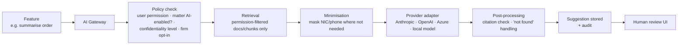

# 14 — AI Opportunities & Guardrails

Covers PART 26.

> **Recommendation: no AI in MVP.** AI is valuable only once documents, OCR text and structured hearing data are in the system and trusted. AI is planned for Phase 3, behind a provider-neutral gateway, with explicit firm opt-in.

---

## 1. Where AI provides genuine value (ranked)

| Rank | Use case | Value | Risk | Phase |
|---|---|---|---|---|
| 1 | **Hearing brief preparation** — assemble last order, outcome history, open tasks, key documents into a one-page brief for the appearing lawyer (much of this is *non-AI aggregation*; AI adds a narrative summary) | High: juniors covering at short notice | Medium (omissions) | Phase 3 (non-AI brief in MVP) |
| 2 | **Court order / judgment summarisation** (Sinhala and English) with page citations | High | Medium–High (misreading orders) | Phase 3 |
| 2a | **General document summarisation** (long pleadings, affidavits, correspondence bundles, migrated files) with page citations | Medium–High | Medium | Phase 3 (after order summaries prove reliable) |
| 3 | **Information extraction** from uploaded documents — case number, court, parties, dates, next date from an order/summons → *pre-fill* forms for human confirmation | High: reduces data entry | Medium | Phase 3 |
| 4 | **Permission-aware semantic search** ("last order in Perera's land case") | High | Medium (leakage if done wrong) | Phase 3 |
| 5 | **Client-update drafting** in the client's language from the recorded outcome | Medium–High | Medium (tone, accuracy) | Phase 3 |
| 6 | **Conflict-match assistance** — explain likely same-person matches across scripts; suggest related entities from documents | Medium | High if trusted blindly | Phase 3 |
| 7 | **Timeline extraction** from a stack of migrated documents | Medium (migration accelerator) | Medium | Phase 3 |
| 8 | **Missing-information detection** — "this hearing has no previous order uploaded", "plaint lists 4 defendants, only 3 recorded" | Medium | Low | Phase 3 (rule-based parts earlier) |
| 9 | **Document comparison** (draft vs filed, amended plaint vs original) | Medium | Low–Medium | Future |
| 10 | **Translation assistance** (Sinhala ↔ English) of documents for internal understanding | Medium | Medium (legal nuance) | Future — always labelled "unofficial machine translation" |

**Not recommended:** AI legal advice, outcome prediction, automated legal research answers presented as authority, judge analytics (ethically sensitive — **[NEEDS LAWYER CONFIRMATION]**).

---

## 2. Separation of AI suggestion and lawyer decision

Every AI output is a **Suggestion** object, never a direct write:

```
AI suggestion (draft, with sources & confidence)
      │
      ▼  human reviews (sees sources side-by-side)
Lawyer decision: Accept | Edit & accept | Reject   ← recorded (who, when, what changed)
      │
      ▼
Domain record created/updated by the human action (audited as human action "from AI suggestion #123")
```

UI rules:
- AI content is visually distinct (label "AI draft — verify before use", distinct styling, icon).
- Every factual claim links to its source document and page where possible.
- AI must say "Not found in the available documents" rather than guess.
- AI text never auto-populates *verified* fields (dates stay Unverified until verified by a person).

---

## 3. Actions AI must never perform autonomously

| Never | Why |
|---|---|
| Decide or clear a conflict | Professional duty |
| Accept or reject a client/engagement | Professional/business decision |
| Verify, change or delete a court date | Highest-risk data |
| Record a hearing outcome as final | Must be the appearing lawyer's record |
| Send any communication to a client or third party | Approval required |
| Submit or file anything with a court/registry | Legal act |
| Delete, alter or re-version documents or evidence | Integrity |
| Change permissions, walls, confidentiality | Security |
| Close, reopen, archive or dispose of a matter | Lifecycle decision |
| Provide final legal advice | Professional duty |
| Access data outside the requesting user's permissions | Confidentiality |
| Merge or unmerge people/organisations, or mark records as duplicates | Identity errors feed conflict checks |
| Mark a document as filed, served or an original | Evidential status is a human attestation |
| Create, assign or complete tasks or deadlines (it may *suggest* them) | Accountability stays with named people |

---

## 4. AI gateway architecture (direction)



| Guardrail | Detail |
|---|---|
| Provider-neutral | `AIProvider` interface; no provider SDK calls outside the gateway |
| Permission filtering | Retrieval runs as the user; same matter filter as search |
| Matter-level switch | AI disabled by default for Highly restricted matters; firm can disable per matter/category |
| Firm opt-in | AI off until the firm signs off on provider, data location and terms |
| Data handling | Providers with no-training and zero/limited retention terms; data-location decision (**[DECISION REQUIRED]**); option for self-hosted model for sensitive firms |
| Prompt injection | Documents from opposing parties may contain hostile text; treat document content as data, never instructions; AI has **no tools that act** (read-only suggestions) |
| Audit | Request (user, feature, matter, documents included, model/version), output, human decision; retention configurable |
| Evaluation | Golden test set per feature (incl. Sinhala documents) before enabling; periodic re-evaluation on model changes |
| Cost control | Per-firm quotas; caching of summaries per document version |

---

### 4.1 Audit events for AI

Every AI request is audited (doc 10 §9): user, feature, matter, documents/chunks retrieved, provider and model version, output, and the human decision (accept / edit / reject). AI audit records follow the matter's retention and legal hold.

---

## 5. Sinhala-specific AI caution

- Model quality in Sinhala legal language varies widely and is generally weaker than English. **Benchmark** on real documents before promising Sinhala summarisation.
- OCR errors compound AI errors — show OCR confidence alongside AI output.
- Summaries default to the user's UI language with the option to view in the document's language.

---

## 6. Non-AI first

Many "AI" wins are achievable with plain software, earlier and more reliably:
- Daily brief = aggregation (MVP).
- Missing-document detection = checklist rules (MVP/Phase 2).
- Case-number extraction from court lists = pattern matching (Phase 2).
- Duplicate detection = deterministic + fuzzy matching (MVP).

Build these first; add AI where rules fall short.
