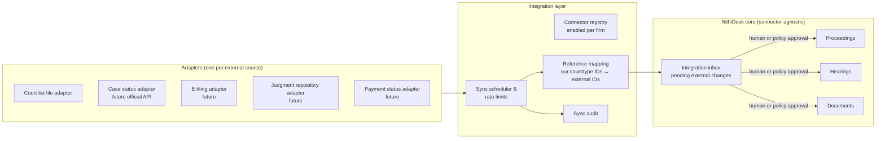

# 15 — Government Court Integration Strategy

Covers PART 27.

> **[NEEDS LAWYER CONFIRMATION]** The current state of Sri Lankan court digitisation (which courts publish case status, court lists or judgments online; any e-filing pilots; any official APIs; terms of use) must be confirmed during discovery. This strategy deliberately **assumes nothing is available** and makes integration additive.

---

## 1. Principles

1. **NithiDesk works fully without any government connection.**
2. **Connectors are adapters at the edge.** No court-specific or government-specific logic inside core modules.
3. **External data is an assertion, not truth** — it enters as a *source* (e.g. a date assertion with source type "Government digital service") and follows the same verification rules, unless the firm explicitly trusts a specific official connector.
4. **Lawful access only.** Use official APIs, published files or user-initiated imports. No scraping that violates terms of use, no credential sharing, no automated bypass of access controls or CAPTCHAs.
5. **Every external sync is auditable** (what came in, when, what changed).

---

## 2. Initial (connector-free) workflows

| Workflow | Phase | Detail |
|---|---|---|
| Manual entry | MVP | All data entered by staff with provenance |
| Lawyer / clerk verification | MVP | Every date — manual, imported or (later) connector-sourced — follows the verification model in doc 06; this is the control that makes imports safe |
| CSV import (matters, proceedings, hearings) | MVP | Dry-run, validation, error report (doc 16) |
| Court-list check-off | MVP | Clerk ticks tomorrow's cases against the list (doc 06 §4.4) |
| Court-list import (CSV/PDF/photo) | Phase 2 | Parse case numbers via configurable patterns; match; human confirms |
| Judgment/order PDF import (incl. certified copies of journal entries) | Phase 2 | Upload; extract metadata (pattern-based; AI-assisted Phase 3); human confirms |
| Email-in | Phase 2 | Forward registry/counsel emails to a matter address |

---

## 3. Connector architecture

### 3.1 Connector contract (conceptual capabilities)

| Capability | Direction | Output into core |
|---|---|---|
| `ListCourtCalendar(court, date)` | Inbound | Listings → matched against hearings → confirmations/alerts |
| `GetCaseStatus(court, caseNumber)` | Inbound | Stage/next-date assertions |
| `GetHearingSchedule(case)` | Inbound | Date assertions |
| `FetchJudgment(case)` / `SearchJudgments` | Inbound | Document import candidates |
| `SubmitFiling(package)` | Outbound | Filing record + status (requires explicit human submit action) |
| `GetFilingStatus(ref)` | Inbound | Filing status updates |
| `GetPaymentStatus(ref)` | Inbound | Court-fee payment status |

Each adapter declares which capabilities it supports. Core code asks "is capability X available for court Y?" — never "is this the Ministry system?".

### 3.2 Integration inbox

All inbound changes land as **proposed changes** (e.g. "External source says next date for DC/L/1234 is 24/11; NithiDesk has 23/11") which a clerk/lawyer accepts or rejects. Firm policy may auto-accept specific low-risk changes from specific trusted official connectors (e.g. auto-verify when an official source *matches* the existing date).

### 3.3 Mapping

- Court identities, case types and case-number formats mapped explicitly (`External reference` records).
- Unmapped external values go to the inbox rather than being guessed.

---

### 3.4 Failure behaviour

- A connector outage or schema change never blocks core work: the adapter is disabled, a P1 admin alert fires, and clerks continue with manual verification.
- External data is never allowed to *downgrade* a human-verified date silently; disagreement creates a conflict state (doc 06).
- Credentials for any official service are held per firm in a secrets store, never shared across firms, never stored in code or logs.

---

## 4. Future capability roadmap (indicative)

| Capability | Value | Dependency |
|---|---|---|
| Official court lists (structured) | Very high — automated verification & missed-listing detection | Publication by courts |
| Case status / next date | Very high | Official API or data feed |
| Judgment retrieval | Medium | Public judgment repositories |
| E-filing | High but complex (digital signatures, formats, fees) | Official e-filing system & legal framework |
| Filing status | Medium | E-filing |
| Payment status | Low–medium | Payment gateway integration by courts |

Phasing: file-based imports Phase 2 (doc 17 §2.2); first official connector Phase 3 only if an official source exists; e-filing, filing status and payment status Future.

---

## 5. Readiness actions now (cheap, high leverage)

1. Model courts and case types as reference data with external-ID slots.
2. Normalise case numbers consistently (key for any matching).
3. Make date provenance first-class (any external source is just another source type).
4. Keep document metadata rich (court, case, document type, date) so future e-filing packages can be assembled.
5. Store documents in standard formats (PDF/A preferred for filed copies — **[NEEDS LAWYER CONFIRMATION]** court requirements).
