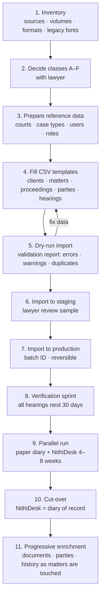

# 16 — Data Migration Plan

Covers PART 29.

> **Principle: migrate what is active and trustworthy; index what is historical; verify every future date by hand.** Do not bulk-import everything automatically.

---

## 1. Assumed current sources (to be inventoried — [NEEDS LAWYER CONFIRMATION])

| Source | Likely contents | Reliability |
|---|---|---|
| Physical court diary | Future and past hearing dates, case numbers, courts, short notes | **High for dates (it is the current truth)**, hard to read |
| Paper case files / briefs | Pleadings, orders, journal copies, client documents, originals | Authoritative but unindexed |
| Excel sheets | Case lists, client lists, maybe hearing lists | Variable; duplicates; stale |
| Word documents | Drafts, pleadings, letters — possibly **legacy Sinhala fonts** | Mixed |
| Shared folders / Google Drive / OneDrive | Scans, drafts, email attachments | Disorganised naming |
| Email | Correspondence with clients, counsel, registries | Partial |
| WhatsApp | Client instructions, photos of documents | Not migrated (reference only) |
| Lawyers' personal notebooks/phones | Personal diaries | Reconcile against main diary |

---

## 2. Migration classes

| Class | What | Method | Verification |
|---|---|---|---|
| **A. Migrate (structured)** | Active clients; active matters; active proceedings (court, case number(s), parties, our side); **all future hearings**; open tasks/deadlines; team assignments | CSV templates filled from Excel + diary transcription; validated import with dry-run | **Every future hearing imported as `Unverified` with source "Migrated from diary/spreadsheet"**; clerk verifies against case records, nearest dates first |
| **B. Migrate (documents, selective)** | For active matters: key documents only — latest pleadings, last 2–3 orders/journal extracts, judgment(s), proxy, key evidence, client ID docs | Scan/upload per matter with category; legacy-font conversion; hash | Lawyer spot-check per matter ("is this the right last order?") |
| **C. Conflict database** | Parties and clients of **closed** matters (names, NIC if held, matter summary, years) | Light CSV import (entities + "historical matter" stubs) | Sampled review; duplicates flagged for merge review |
| **D. Archive (indexed, not structured)** | Closed matter files on shared drives | Bulk import into an **archive area** as read-only documents with minimal metadata (folder name → client/matter guess), searchable by filename/OCR later | None up front; corrected on access |
| **E. Leave in place / paper** | Old paper files of closed matters; originals | Physical file register (box/location) entries only | — |
| **F. Do not migrate** | Duplicates, personal notes unrelated to matters, data without purpose, expired retention data (after lawyer approval) | — | Lawyer decision |

### 2.1 Source → class matrix

| Source | Migrate (A/B/C) | Archive (D/E) | Manual verification |
|---|---|---|---|
| Physical court diary | **A** — all future hearings; past 6–12 months of entries for active matters as hearing history (**[MAKE CONFIGURABLE]** depth) | Scan the old diaries as read-only PDFs (E-style reference) | Every future date (§3) |
| Paper case files | **B** — key documents for active matters | **E** — physical file register entries for closed files | Lawyer spot-check of "last order" |
| Excel sheets | **A** — clients, matters, proceedings, parties; **C** — closed-matter parties | Original spreadsheets kept read-only as import evidence | Duplicates, case numbers, matter ↔ proceeding grouping |
| Word documents | **B** — current drafts and filed pleadings of active matters | **D** — the rest | Legacy-font conversion sample |
| Shared folders / Google Drive / OneDrive | **B** — selected per active matter | **D** — bulk, read-only, by folder | Folder → matter mapping confirmed by assistant |
| Email | Selectively saved to the matter as communications/documents (by forwarding or upload) — **no bulk mailbox import** | Mailboxes stay in the firm's email system | Lawyer chooses what is part of the matter record |
| WhatsApp | Not migrated; important instructions re-recorded as communication-log entries with reference (doc 04 §7) | Stays on devices | Lawyer judgement |
| Personal notebooks / phones | Reconcile dates into A | — | Clerk reconciliation against the diary |

---

## 3. What requires manual verification

| Item | Why | How |
|---|---|---|
| **Every future hearing date** | Transcription errors are the #1 migration risk | Clerk verifies from case record/court list; dashboard tracks "% verified" — **go-live gate: 100% of hearings in the first 14 days verified** |
| Case numbers | Typos break search and future connector matching | Validate against configurable patterns; lawyer confirms flagged ones |
| Party roles and ordinals | Spreadsheets rarely hold this | Lawyer completes for active proceedings over first weeks (progressive) |
| Client identity (merge candidates) | Same person, different spellings | Duplicate review queue |
| Matter ↔ proceeding grouping | Old files may treat each case as a separate "file" | Lawyer groups related cases into one matter (appeals under original matter) |
| Converted Sinhala text | Legacy-font conversion errors | Human spot-check sample per document batch |
| Confidentiality levels | Not recorded anywhere today | Partner classifies sensitive matters before go-live |
| Team assignments / access | Needed for permissions | Partner confirms per matter |

---

## 4. Migration process

### 4.1 Import tooling requirements

- CSV templates per entity, bilingual headers, UTF-8 (with Excel-friendly BOM option).
- **Dry-run mode**: full validation with no writes; downloadable error report (row, field, problem, suggestion).
- Validations: required fields, court exists, case-number pattern (warn), date validity/past-future, duplicate detection (within file and against existing data), referential integrity (hearing → proceeding exists).
- Every imported record tagged with **import batch ID** and source; batches can be rolled back if not yet modified.
- Imports audited.
- Legacy Sinhala font detection & conversion for DOC/DOCX text and spreadsheet cells (FM/DL-family mappings — **[NEEDS LAWYER CONFIRMATION]** fonts in use).

### 4.2 Cut-over safety for the diary

- Parallel run: the physical diary continues for 4–8 weeks (**[MAKE CONFIGURABLE]** with the firm); daily reconciliation report "dates in NithiDesk next 7 days" printed for the clerk to compare.
- Cut-over criteria: zero discrepancies for 2 consecutive weeks; 100% of next-14-day hearings verified; outcomes recorded same-day ≥ 90% during parallel run.
- After cut-over, the paper diary may remain as a read-only backup or a daily printed copy (business-continuity fallback, doc 19).

---

## 5. Volume & effort assumptions

**[ASSUMPTION]** pilot firm: 300–1,500 active matters; 50–200 hearings per week; 5–20 years of closed files. Transcribing future hearings and active matters is likely **2–4 person-weeks** of clerk/assistant effort; document scanning for active matters depends heavily on volume — budget separately. These numbers must be replaced after inventory.

---

## 6. Data protection during migration

- Work on firm premises or encrypted devices; no personal laptops/USBs without encryption.
- Spreadsheets with NIC/client data deleted from temporary locations after import (with lawyer approval).
- Migration staff under confidentiality obligations.
- Migration activity logged.
- Cloud-drive exports (Google Drive/OneDrive) taken by the firm's own account holders; NithiDesk staff do not receive the firm's cloud credentials.

---

## 7. Rollback and failure handling

- Each batch can be rolled back until any record in it is modified; after that, corrections are made record by record (audited).
- If the parallel run shows discrepancies, cut-over is postponed — the paper diary stays the diary of record until the criteria in §4.2 are met.
- A frozen copy of every source file used for import is retained (encrypted, access-restricted) until the post-go-live review, then disposed of per lawyer instruction.
