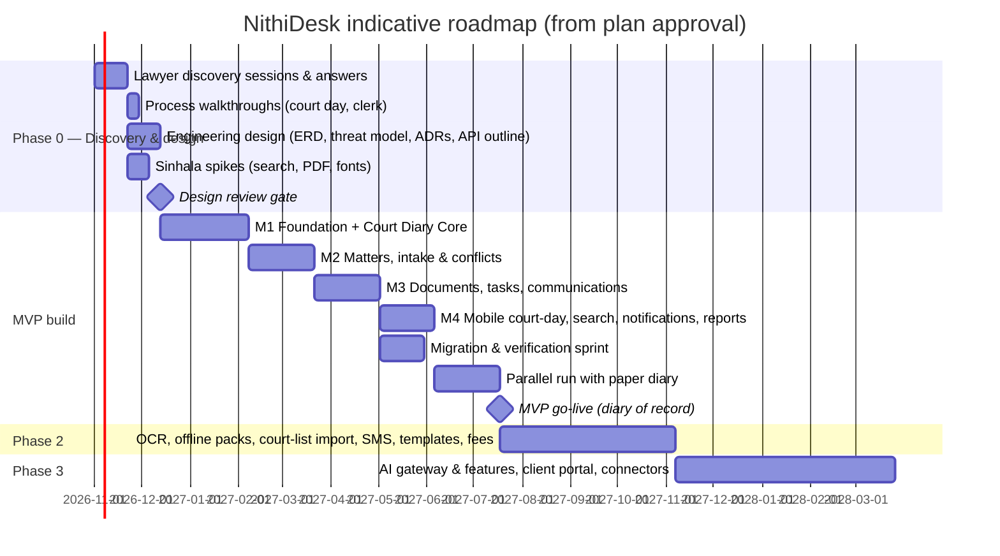
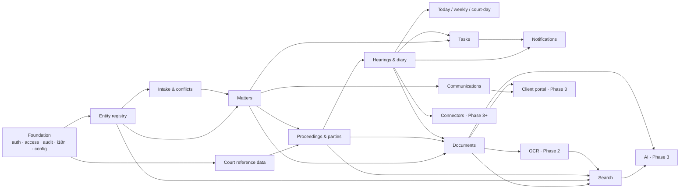

# 18 — Product Roadmap

Timeframes are indicative (**[ASSUMPTION]** small team, see doc 17 §5) and start from approval of the plan.

---

## 1. Phase overview

---

## 2. Milestones

### Phase 0 — Discovery & design (≈ 4–6 weeks)

| Deliverable | Gate |
|---|---|
| Answers to doc 20 questions (at least the "must answer before coding" set) | Lawyer sign-off |
| Observed walk-through: one court day with a junior; one day with the clerk | Notes added to docs |
| Updated planning docs v0.2 | Owner review |
| Architecture Decision Records (stack, tenancy, hosting, auth, storage, search, PDF) | Owner approval |
| Threat model, conceptual → logical data model, API outline | Review |
| **Spikes** (throwaway code allowed, clearly separated): Sinhala normalisation + cross-script name matching on sample names; bilingual PDF rendering; Sinhala UI layout on low-end Android | Results documented |
| Court reference data compiled (courts the firm attends first) | Clerk verified |

### M1 — Foundation + Court Diary Core (recommended first development milestone)

Goal: **a working, secure, bilingual court diary the clerk and lawyers could use on its own.**

- Repository, CI with quality gates, environments, backups + restore test.
- Authentication with MFA, sessions, role templates, matter-level access (basic), audit log framework.
- Localisation framework (si/en, dual-label), Sinhala fonts, pseudo-localisation check.
- Court reference data; minimal matter (number, title, client name, team) and proceeding (court, case-number history, parties-lite).
- Hearings with date assertions, verification state, listing status, outcome → next hearing.
- Today view (desktop + mobile), weekly view, verification queue, outcome-not-recorded queue.
- CSV import of matters/proceedings/hearings (dry-run) — so the pilot firm's diary can be loaded early.
- Daily brief (in-app) and bilingual printable PDF (retires the PDF risk).

Exit criteria: clerk can load next month's diary, verify dates, lawyers can see Today and record outcomes on phones; security & authorisation tests green.

### M2 — Matters, intake & conflicts

Full entity registry, clients, enquiries, conflict search & decisions, engagement, full matter model, related matters, proceeding relationships, full party roles, ethical walls, confidentiality levels.

### M3 — Documents, tasks, communications

Upload pipeline (scan, hash, versions, previews), categories, links, originals register, tasks with reviewers/deadlines, communications log, client update drafting & approval, timeline.

### M4 — Mobile court-day polish, search, notifications, reports

Court-day case card complete, offline-tolerant outcome queue, global grouped search incl. cross-script, notification priorities/escalations/email digests, basic reports, closure workflow.

### Migration, parallel run, go-live

Per doc 16. Go-live = NithiDesk becomes the diary of record.

### Phase 2 and Phase 3

As in doc 17 §2.2–2.3. Re-prioritise with pilot feedback; do not pre-commit order beyond Phase 2.

---

## 3. Module dependencies

Note: M1 deliberately builds a **thin slice** of Registry/Matters/Proceedings so Hearings can ship first; M2 deepens them. The conceptual model (doc 08) is designed in full in Phase 0 so the thin slice doesn't need rework.

---

## 4. Decision gates

| Gate | Before | Decisions |
|---|---|---|
| G0 | Any production code | Doc 20 "before coding" answers; ADRs; tenancy; hosting/residency; auth approach |
| G1 | M2 | Conflict policy, approval levels, ethical wall practice |
| G2 | M3 | Document taxonomy, retention classes, confidentiality defaults |
| G3 | Go-live | Migration verification complete, pentest, restore drill, cut-over criteria |
| G4 | Phase 2 | Billing scope, SMS provider & cost, OCR benchmark results |
| G5 | Phase 3 | AI opt-in (provider, data location), client portal demand |
