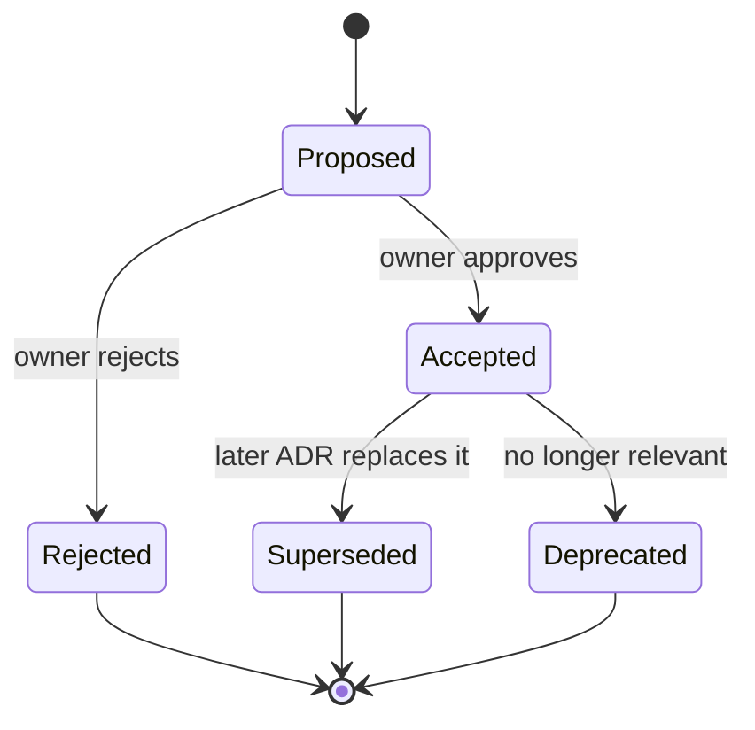

# Architecture Decision Records

Architecture Decision Records (ADRs) capture the hard-to-reverse technical decisions for NithiDesk, the reasons behind them and the alternatives considered. Each record is short, dated and never rewritten after it is accepted. A later decision **supersedes** it instead.

Format: [MADR](https://adr.github.io/madr/)-style (see template below). Markers follow the planning pack: **[DECISION REQUIRED]** · **[NEEDS LAWYER CONFIRMATION]** · **[MAKE CONFIGURABLE]** · **[ASSUMPTION]**.

## Status lifecycle



- **Proposed:** drafted and open for review. Code may be written as a spike, but M1 feature work must not depend on it (Gate G0, [doc 18 §4](../18-product-roadmap.md)).
- **Accepted:** approved by the product owner. The record is then frozen apart from typo fixes and links.
- **Superseded by ADR-NNNN / Deprecated:** kept for history.

Approval happens on the pull request that changes the status line to `Accepted`. The linked GitHub issue is then closed.

## Index

| # | Title | Status | Issue | Blocked on |
|---|---|---|---|---|
| [0000](0000-record-architecture-decisions.md) | Record architecture decisions | Proposed | — | — |
| [0001](0001-backend-stack-and-module-layout.md) | Backend stack and module layout | Proposed | #17 | Go version check |
| [0002](0002-tenancy-model.md) | Tenancy model | Proposed | #18 | Owner decision #13 |
| [0003](0003-hosting-and-deployment.md) | Hosting and deployment | Proposed | #19 | Owner decision #12, lawyer Q10 (#11), PDPA |
| [0004](0004-authentication-and-sessions.md) | Authentication and sessions | Proposed | #20 | Owner decision #14 |
| [0005](0005-file-storage.md) | File storage | Proposed | #21 | Hosting (0003) |
| [0006](0006-search.md) | Search | Proposed | #22 | Spike #25 |
| [0007](0007-pdf-generation.md) | PDF generation | Proposed | #23 | Spike #26 |
| [0008](0008-frontend.md) | Frontend | Proposed | #24 | Spike #27 (partly) |

## Template

```markdown
# NNNN. Title

- **Status:** Proposed | Accepted | Rejected | Superseded by NNNN | Deprecated
- **Date:** YYYY-MM-DD
- **Issue:** #NN
- **Deciders:** product owner (approves); lead engineer (proposes)
- **Related:** planning docs, other ADRs

## Context
What forces are at play; what the planning docs require.

## Decision drivers
- ...

## Considered options
1. Option A
2. Option B
3. Option C

### Option A
- Good, because ...
- Bad, because ...

## Decision
Chosen option, and why, in one paragraph.

## Consequences
- Positive: ...
- Negative / costs: ...
- Follow-up work: ...

## Confirmation
How we will know the decision is implemented and still right (tests, review, spike results, metrics).

## Open questions
- ... [DECISION REQUIRED] / [NEEDS LAWYER CONFIRMATION]
```
