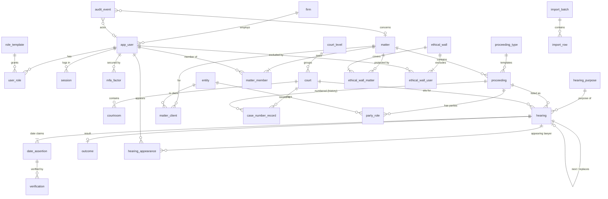

# Logical Data Model (draft)

> Status: **DRAFT for Phase 0 review** — refs issue #29. Refines the conceptual model in [doc 08](../08-information-model.md) and [diagrams/information-relationships](../diagrams/information-relationships.md).
> This is a **logical** model: entities, attributes, logical types, keys, cardinality and invariants. It is **not** DDL and creates no migrations. Physical design (table split, indexes, partitioning) follows the ADRs and Gate G0 answers.
> Markers: **[NEEDS LAWYER CONFIRMATION]** · **[MAKE CONFIGURABLE]** · **[ASSUMPTION]** · **[DECISION REQUIRED]**.

---

## 1. Conventions

### 1.1 Logical types

| Logical type | Meaning | Postgres mapping (indicative) |
|---|---|---|
| `id` | Surrogate key | see §1.2 |
| `ref(X)` | Reference to entity X (foreign key) | same type as X's `id`; every FK gets an index |
| `text` | Unbounded Unicode text, NFC-normalised on write | `text` (no `varchar(n)`; length rules are `check` constraints) |
| `text_i18n` | Parallel name/title in each UI language: `{en, si, ta}` — each optional, at least one required | three columns `*_en`, `*_si`, `*_ta` (not JSON: they are searched, sorted and indexed) |
| `search_shadow` | Machine-maintained normalised form for matching (see §1.4) | generated or trigger-maintained `text`; trigram index |
| `local_date` | Calendar date with **no time zone** (court dates, deadlines) | `date` |
| `instant` | Point in time | `timestamptz`, stored UTC |
| `code` | Value from a closed enumeration | `text` + `check` constraint (cheaper to evolve than enum types) |
| `ref_code` | Value from configurable reference data (court, purpose, role…) | `ref` to a reference-data entity |
| `money` | Amount in LKR | `numeric(14,2)` |
| `bool` | | `boolean not null` with explicit default |
| `json` | Opaque, never queried by business logic (e.g. audit before/after) | `jsonb` |

Identifiers are lower-case snake_case.

### 1.2 Keys — **[DECISION REQUIRED] (ADR: backend stack / tenancy, issues #17, #18)**

| Option | For | Against |
|---|---|---|
| **UUIDv7** everywhere (native `uuidv7()` in PostgreSQL 18; extension or app-generated on older versions) | IDs can be generated **on the phone** for the offline outcome queue; safe to expose in URLs (not enumerable); merge-friendly for future multi-firm or import; time-ordered, so no index fragmentation | 16 bytes; leaks creation time (acceptable) |
| `bigint identity` | Smallest, fastest, SQL-standard | Enumerable in URLs (needs separate public ID); can't be minted offline; harder imports |

**Recommendation:** UUIDv7 for all business entities. Reference-data codes keep a stable human `code` as well (e.g. `court.code = 'DC-COLOMBO'`). Audit events may use `bigint identity` because they are never exposed or minted offline.

### 1.3 Columns present on every business record

| Column | Type | Rule |
|---|---|---|
| `id` | `id` | immutable |
| `firm_id` | `ref(firm)` | **on every record, including reference data and audit** (D10). Part of every unique constraint and every query predicate. Composite FKs `(firm_id, id)` stop a row pointing across firms |
| `created_at`, `created_by` | `instant`, `ref(user)` | `created_by` null only for system/connector/import (then `created_via` says which) |
| `updated_at`, `updated_by` | `instant`, `ref(user)` | |
| `row_version` | integer | incremented on every update; exposed as the API ETag (optimistic concurrency) |
| `deleted_at`, `deleted_by`, `delete_reason` | `instant`, `ref(user)`, `text` | soft-delete only where §9 allows; null = live |

Append-only records (date assertions, verifications, conflict decisions, custody events, audit) have **no** `updated_*`, `row_version` or `deleted_*`.

### 1.4 Bilingual names and search shadows (D8)

- Names and titles: `text_i18n`. Free text (notes, purposes, instructions) is a single `text` in whatever script the author used.
- Every searchable name has shadows, maintained by the application's Sinhala text service (the exact rules come out of spike #25):
  - `name_norm` — NFC, zero-width joiner/non-joiner rules applied, case-folded, punctuation and honorifics stripped.
  - `name_translit` — Latin transliteration of the Sinhala/Tamil form, so a Sinhala name matches an English-typed query (and vice versa).
- Trigram indexes on shadows; full-text search configuration per language. **[ASSUMPTION]** Postgres FTS + `pg_trgm` is sufficient for MVP (ADR #22).

### 1.5 Row-level security as defence in depth

Authorisation is decided in `internal/authz` and applied inside every query (doc 09). **[DECISION REQUIRED]** whether to *also* enable Postgres RLS on `firm_id` (cheap, catches a missing tenant predicate). Matter ACL and walls stay in the application policy, not RLS, because they need the full four-layer rule.

---

## 2. M1 subset at a glance

M1 = "Foundation + Court Diary Core" (doc 18). Entities marked **M1** are built in M1. **M1-thin** means built with a reduced attribute set in M1 and completed in M2. Everything else is later.

---

## 3. Identity & access

| Entity | Phase | Key attributes | Keys / constraints |
|---|---|---|---|
| `firm` | M1 | `name text_i18n`, `default_locale code(en,si)`, `time_zone text` (= `Asia/Colombo`), `settings json` | tenant root; `firm_id = id` |
| `app_user` | M1 | `entity_id ref(entity)?` (a lawyer is also a registry entity, M2), `email text`, `display_name text_i18n`, `preferred_locale code`, `status code(active, disabled, invited)`, `password_hash text` (argon2id), `password_changed_at instant`, `last_login_at instant` | unique `(firm_id, lower(email))` |
| `mfa_factor` | M1 | `user_id`, `kind code(totp, webauthn, recovery_codes)`, `secret_encrypted bytes`, `confirmed_at instant`, `last_used_at instant` | ≥1 confirmed factor required for an active internal user (invariant enforced at login) |
| `session` | M1 | `user_id`, `token_hash bytes` (the cookie carries the raw token, only the hash is stored), `created_at`, `last_seen_at`, `idle_expires_at`, `absolute_expires_at`, `mfa_satisfied_at instant?`, `step_up_at instant?`, `device_label text`, `ip inet`, `user_agent text`, `revoked_at`, `revoked_reason code` | unique `token_hash`; idle 30 min desktop / 15 min mobile; absolute 12 h (doc 10 §4) |
| `quick_unlock_pin` | M1 | `session_id`, `pin_hash`, `failures int` | 5 failures → session revoked |
| `role_template` | M1 | `code`, `name text_i18n`, `capabilities code[]`, `matter_scope code(member, diary, all_non_walled, none)`, `is_system bool` | unique `(firm_id, code)` |
| `user_role` | M1 | `user_id`, `role_template_id`, `valid_from instant`, `valid_to instant?` | |
| `matter_member` | M1 | `matter_id`, `user_id`, `team_role code(responsible_partner, lead, supporting, clerk, assistant)`, `valid_from local_date`, `valid_to local_date?` | team history is kept; current = `valid_to is null`; exactly one current `responsible_partner` and one current `lead` per open matter |
| `ethical_wall` | M1 | `reason text`, `source_conflict_decision_id ref?` (M2), `starts_on local_date`, `review_on local_date?`, `removed_at instant?`, `removal_approved_by ref(user)[]` | removal needs two approvers **[MAKE CONFIGURABLE]** |
| `ethical_wall_matter`, `ethical_wall_user` | M1 | link rows | adding a walled user to a matter team or hearing appearance is rejected (invariant I-AC-2) |
| `access_grant` | Phase 2 | appearance-scoped / external counsel, time-boxed | doc 09 §2.2 |

**Access invariants**

- **I-AC-1** Access = role capability ∧ matter access ∧ record restriction ∧ ¬wall. Evaluated by `internal/authz` for every read path, including counts and queues (see the scaffold's `RequiredReadPathScenarios`).
- **I-AC-2** A user in a wall covering matter M can never be a current `matter_member` of M or a `hearing_appearance` on M's hearings.
- **I-AC-3** System administrator role has `matter_scope = none`; no grant can change that (doc 09).
- **I-AC-4** Not-visible reads return *not found*, never *forbidden* (scaffold `internal/authz` doc).

> **Divergence to resolve:** doc 09 §2 gives the Managing Partner template a default scope of "all non-walled matters (configurable)", whereas the scaffold's authorisation scenario `managing_partner_is_not_implicitly_on_every_matter` requires team membership. This model supports both through `role_template.matter_scope`; the **default** must be decided — **[NEEDS LAWYER CONFIRMATION]** (G0 question 8).

---

## 4. Registry (people and organisations) — M1-thin, full in M2

| Entity | Phase | Key attributes | Constraints |
|---|---|---|---|
| `entity` | M1-thin | `kind code(person, organisation, government_body)`, `name text_i18n`, `name_norm`, `name_translit` (search shadows), `short_name text?`, `preferred_locale code?`, `merged_into_id ref(entity)?` | merged entities stay as tombstones pointing at the survivor (unmerge possible) |
| `name_variant` | M2 | `entity_id`, `value text`, `script code(sinh, latn, taml)`, `kind code(alias, former, transliteration, misspelling)`, shadows | used by conflict search |
| `identifier` | M2 | `entity_id`, `kind code(nic_old, nic_new, passport, company_reg, br, other)`, `value_encrypted bytes`, `value_hash bytes` (for exact match), `last4 text` (for display) | unique `(firm_id, kind, value_hash)` → **warning**, not error (data can be wrong) |
| `contact_point`, `address` | M2 | phone/email/postal; `is_primary bool`; address `text_i18n` lines + district/province `ref_code` | |
| `entity_relationship` | M2 | `from_entity_id`, `to_entity_id`, `kind ref_code` (spouse, parent, director_of, shareholder_of, employee_of…), `valid_from/valid_to local_date?` | |
| `client_profile` | M2 | `entity_id` (1:0..1), `status code(prospective, active, former)`, `onboarded_on local_date`, `kyc json?` | M1 uses `matter_client` directly against `entity` |

In M1 the importer and the matter form create **thin** entities (kind + name in one or both scripts). M2 adds deduplication and merge.

---

## 5. Matters

| Entity | Phase | Key attributes | Constraints / invariants |
|---|---|---|---|
| `matter` | M1-thin | `matter_number text` (firm format **[MAKE CONFIGURABLE]**, e.g. `2026/LIT/0142`), `title text_i18n`, `practice_area ref_code`, `category ref_code?`, `lifecycle code(intake, open, closing, closed, archived)`, `phase code?` (M2), `priority code(normal, high, urgent)`, `confidentiality code(standard, restricted, highly_restricted)`, `opened_on local_date`, `closed_on local_date?`, `billing_arrangement code?` (Phase 2) | unique `(firm_id, matter_number)`; `closed_on` set iff lifecycle ∈ {closed, archived} |
| `matter_client` | M1 | `matter_id`, `entity_id`, `client_role code(primary, co_client, guarantor…)` | ≥1 per matter (deferred check at commit) |
| `matter_link` | M2 | `from_matter_id`, `to_matter_id`, `kind ref_code(related, same_case_as, successor_of…)` | |
| `matter_status_event` | M2 | `from_lifecycle`, `to_lifecycle`, `reason text`, `approved_by ref(user)?` | append-only; closure needs partner approval |

Attention flags (unverified upcoming hearing, outcome not recorded, overdue task) are **derived**, never stored as truth (doc 08 §5).

---

## 6. Courts and reference data — M1

All reference data is per firm, versioned by `valid_from/valid_to`, and editable only by roles with `config.manage`. Each item has a stable `code` and a `name text_i18n`.

| Entity | Key attributes | Notes |
|---|---|---|
| `court_level` | `code` (mc, pc, dc, hc, phc, hcca, chc, ca, sc, lt), `rank int` | doc 05 §2 **[NEEDS LAWYER CONFIRMATION]** on the final list |
| `court` | `court_level_id`, `location ref_code` (judicial zone/district), `address text_i18n`, `case_number_patterns json` (regex + normaliser per proceeding type), `sits_on code[]?` | example: `DC-COLOMBO` |
| `courtroom` | `court_id`, `label text` | |
| `court_calendar_day` | `court_id?` (null = all courts), `day local_date`, `kind code(holiday, vacation, not_sitting)` | drives "court not sitting" warnings |
| `proceeding_type` | `court_level_id`, `case_category code(civil, criminal, appellate, writ, fr, labour, testamentary, other)`, `party_role_set_id`, `stage_catalogue_id`, `purpose_catalogue_id` | doc 05 §3 |
| `party_role_type` | `code`, `name text_i18n`, `side code(applicant_side, respondent_side, neutral)` | doc 04 §5.2 |
| `hearing_purpose` | `code`, `name text_i18n`, `proceeding_type_ids ref[]` | **[MAKE CONFIGURABLE]** |
| `outcome_type` | `code`, `requires_next_hearing bool`, `concludes_proceeding bool` | adjourned, part-heard, judgment reserved, judgment delivered, settled, withdrawn, laid_by… |
| `relationship_type` | `code`, `allowed_pairs json` | `appeal_of`, `revision_of`, `transferred_from`, `committed_from`… (doc 05 §5) |
| `date_source_type` | `code`, `default_authority code(authoritative, primary, secondary, hearsay)` | mapping **[MAKE CONFIGURABLE]** (doc 06 §3) |

Reference rows are never hard-deleted; they are end-dated so historical records still resolve.

---

## 7. Proceedings and parties

### 7.1 Proceeding — M1-thin

| Attribute | Type | Notes |
|---|---|---|
| `matter_id` | `ref(matter)` | exactly one owning matter (I-PR-1) |
| `proceeding_type_id` | `ref_code` | |
| `current_court_id` | `ref(court)` | denormalised from the current case-number record for queries; kept consistent by the same transaction |
| `title text_i18n?` | | defaults to "Plaintiff v. Defendant" generated from parties |
| `our_side code` | | plaintiff_side / defendant_side / petitioner / respondent / accused / complainant / intervenient |
| `our_role code` | | attorney_on_record / counsel_only / watching_brief **[NEEDS LAWYER CONFIRMATION]** |
| `instituted_on local_date?` | | |
| `status code(active, dormant, concluded, transferred_out)` | | |
| `outcome_type_id ref_code?` | | required when `status = concluded` |
| `current_stage_id ref_code?` | | M2 |
| `confidentiality_override code?` | | may only be **stricter** than the matter (I-PR-4) |

### 7.2 Case-number history (D3) — M1

`case_number_record`: `proceeding_id`, `court_id`, `raw text` (as written), `normalised text` (from the court's pattern normaliser), `valid_from local_date`, `valid_to local_date?`, `reason code(assigned, corrected, renumbered, transferred, pending)`, `source text?`.

- **I-PR-2** At most **one current** record per proceeding (`valid_to is null`) — partial unique index on `(proceeding_id) where valid_to is null`.
- A proceeding may have **zero** records while the number is "to be assigned"; the UI shows "No case number yet" and the court-list check lists it separately (doc 06 §4.4).
- **I-PR-3** `(firm_id, court_id, normalised)` among current records is *expected* unique; a duplicate produces a **warning** that names the existing matter (if visible to the caller), not a hard error (doc 05 §4.2, **[NEEDS LAWYER CONFIRMATION]**).
- Search matches **any** record, current or historical.
- Corrections end-date the wrong record with `reason = corrected`; nothing is deleted.

### 7.3 Proceeding relationship graph — M1 for `appeal_of`/`transferred_from`, rest M2

`proceeding_relationship`: `from_proceeding_id`, `to_proceeding_id`, `relationship_type_id`, `noted_on local_date?`, `note text?`.

- Directed, typed edges; symmetric types (`consolidated_with`, `connected_with`) are stored once with the lower id first.
- **I-PR-5** No self-edges; no cycles among the "derivation" types (`appeal_of`, `revision_of`, `transferred_from`, `committed_from`, `leave_to_appeal_from`, `appeal_after_leave`), checked in the application on insert.
- **I-PR-6** Cross-matter edges are allowed only through an explicit matter link (M2).
- The **original proceeding** is derived (root of the derivation graph), never stored.
- An appeal never mutates the original; the original's status changes by event.

### 7.4 Parties — M1-thin

`party_role`: `proceeding_id`, `entity_id`, `party_role_type_id`, `ordinal int?` ("1st Defendant"), `side code`, `is_our_client bool`, `status code(active, substituted, removed, deceased)`, `from_on local_date?`, `to_on local_date?`, `substituted_by_id ref(party_role)?`, `derived_from_id ref(party_role)?` (the role in the lower-court proceeding, for compound appellate titles).

- Unique `(proceeding_id, party_role_type_id, ordinal)` among active rows.
- `representation` (M2): `party_role_id`, `lawyer_entity_id`, `capacity code(attorney_on_record, counsel, instructing_attorney)`, dates.

M1 records "main parties" only (enough for "Perera v. Silva (+3)").

---

## 8. Hearings — M1 (the core)

### 8.1 Hearing

| Attribute | Type | Notes |
|---|---|---|
| `proceeding_id` | `ref` | mandatory; matter derived through proceeding |
| `court_id`, `courtroom_id?` | `ref` | default from proceeding; may differ per sitting |
| `hearing_date` | `local_date` | **denormalised current date** — the value of the current effective assertion (§8.2); maintained in the same transaction; used for every diary query |
| `session` | `code(morning, afternoon, unspecified)` | |
| `time_of_day` | local time? | optional |
| `purpose_id` | `ref_code` | plus `purpose_note text` |
| `listing_status` | `code(scheduled, held, not_reached, court_not_sitting, vacated, cancelled, outcome_recorded)` | Dimension A, doc 06 §4.2 |
| `verification_state` | `code(unverified, verified, conflict)` | Dimension B; **derived** from assertions + verifications, cached here, recomputed on every assertion/verification write |
| `preparation_status` | `code(not_started, in_progress, ready, blocked)` | M3 checklist drives it; M1 manual |
| `previous_hearing_id` | `ref(hearing)?` | chain |
| `replaces_hearing_id` | `ref(hearing)?` | set when created as the replacement of a vacated hearing |
| `instructions text?`, `notes text?` | | record restriction applies to notes |
| `assigned_clerk_id ref(user)?` | | |
| `cancel_reason text?` | | required when `cancelled` |
| `import_row_id ref?` | | provenance when imported |

`hearing_appearance`: `hearing_id`, `user_id` (or `entity_id` for external counsel, M2), `capacity code(appearing, instructing, observing)`.

"Verification overdue" is **computed at read time**: `verification_state = unverified` and `hearing_date` within the configured working-day window (court calendar aware).

### 8.2 Date assertions and verification (D4)

`date_assertion` (append-only):

| Attribute | Type |
|---|---|
| `hearing_id` | `ref` |
| `asserted_date` | `local_date` |
| `asserted_session` / `asserted_time` | `code` / time? |
| `source_type_id` | `ref_code(date_source_type)` |
| `authority` | `code(authoritative, primary, secondary, hearsay)` — copied from the source type at write time so later config changes do not rewrite history |
| `source_detail` | `text` (JE number, court-list date, email subject…) |
| `evidence_document_id` | `ref(document)?` (M3) |
| `kind` | `code(initial, correction, from_outcome, from_court_list, from_import, from_connector)` |
| `supersedes_id` | `ref(date_assertion)?` |
| `asserted_by`, `asserted_at` | `ref(user)?`, `instant` |
| `idempotency_key` | `text?` (offline queue) |

`verification` (append-only): `hearing_id`, `date_assertion_id` (exactly the assertion being confirmed), `authoritative_source_type_id`, `evidence_reference text`, `verified_by`, `verified_at`, `revoked_at instant?`, `revoked_by?`, `revoke_reason text?`. Revocation is the only permitted change and is itself audited.

**Derivation rule (single source of truth, implemented once in the Hearings module):**

1. The **current assertion** is the latest assertion not superseded.
2. If any **unrevoked verification** confirms the current assertion → `verified`.
3. Else if the current assertion's date differs from a date that was previously verified, or two non-superseded assertions disagree → `conflict`.
4. Else → `unverified`.
5. `hearing.hearing_date` := current assertion's date.

Invariants:
- **I-HE-1** Every hearing has ≥1 assertion (created in the same transaction).
- **I-HE-2** Assertions and verifications are never updated or deleted (DB role has no UPDATE/DELETE on them).
- **I-HE-3** A verification must reference an assertion of the same hearing, and its source must be of `authoritative` authority unless firm policy allows `primary` **[MAKE CONFIGURABLE]** (doc 06 §4.3). AI never creates verifications.
- **I-HE-4** A new assertion that contradicts a verified date moves the hearing to `conflict` — never silently to the new date.
- **I-HE-5** "Date recorded wrongly" = new assertion on the **same** hearing (`kind = correction`). "Court changed the date" = `listing_status → vacated` + a **new** hearing with `replaces_hearing_id` set (doc 06 §3).

### 8.3 Outcome — M1

`outcome` (one effective per hearing; corrections are new rows with `corrects_id`): `hearing_id`, `outcome_type_id`, `summary text`, `order_text text?`, `next_hearing_id ref(hearing)?`, `no_next_reason code(concluded, laid_by, date_from_registry, other)?`, `no_next_note text?`, `recorded_by`, `recorded_at`, `client_recorded_at instant` (device time, for offline), `idempotency_key text` (unique per firm).

- **I-OU-1** `next_hearing_id` **xor** `no_next_reason` must be set (check constraint). `date_from_registry` also creates an urgent clerk task (M3; M1 = queue entry).
- **I-OU-2** Recording an outcome atomically: inserts outcome, creates the next hearing with a `from_outcome` assertion (authority = primary), sets `listing_status = outcome_recorded`, links `previous_hearing_id`. All or nothing.
- **I-OU-3** Only past or same-day hearings (court calendar date in `Asia/Colombo`) can receive an outcome.
- **I-OU-4** Re-submitting the same `idempotency_key` returns the original result (offline queue replay).
- **I-OU-5** A hearing whose date has passed with `listing_status ∈ {scheduled}` appears in the **outcome-not-recorded** queue (derived).

---

## 9. Soft-delete, retention and legal hold

| Concept | Meaning | Applies to |
|---|---|---|
| **Cancel / end-date** | Business state change; the record stays fully visible | hearings, tasks, team membership, reference data |
| **Soft-delete** | "Created in error": hidden from normal views, kept for audit; needs reason; restorable by a partner | proceedings (doc 08 §4), parties, document versions, communications within the edit window |
| **Append-only** | Never edited or deleted by the application | date assertions, verifications, outcomes (corrected by new rows), conflict decisions, custody events, audit |
| **Purge** | Physical deletion | only via the retention/disposal workflow (Phase 2), never while a hold applies |
| **Legal hold** | Freezes purge and soft-delete for everything in scope | client, matter, proceeding or document (M2/Phase 2) |

`legal_hold`: `scope_kind code(client, matter, proceeding, document)`, `scope_id`, `reason text`, `issued_by`, `issued_at`, `released_by?`, `released_at?`, `release_approved_by?`.
- **I-LH-1** While any unreleased hold covers a record (directly or through its matter/client), soft-delete and purge are rejected.
- Holds are released, never deleted.

M1 implements soft-delete columns and the append-only rules; legal hold is modelled now but built with documents (M3) because that is where the deletion risk is.

---

## 10. Audit — M1

`audit_event` (append-only, `bigint identity` key, partitioned by month **[ASSUMPTION]** physical choice):

| Attribute | Type |
|---|---|
| `firm_id` | `ref` |
| `occurred_at` | `instant` |
| `actor_kind` | `code(user, system, connector, import)` |
| `actor_user_id` | `ref(user)?` |
| `session_id`, `request_id` | `ref?`, `text` (matches the scaffold's `X-Request-Id`) |
| `ip`, `user_agent` | `inet?`, `text?` |
| `action` | `code` (e.g. `hearing.date_asserted`, `hearing.verified`, `matter.opened`, `auth.login_failed`) |
| `target_kind`, `target_id` | `code`, `id?` (by reference; no FK) |
| `matter_id` | `ref?` — so the audit trail can be filtered without exposing walled matters |
| `result` | `code(success, denied, not_found, error)` |
| `reason` | `text?` |
| `changes` | `json?` (before/after of business fields; **never** secrets, file content or full NIC) |
| `prev_hash`, `hash` | bytes (hash chain for tamper evidence) |

- **I-AU-1** No application path updates or deletes audit rows; the application DB role has INSERT/SELECT only (scaffold scenario `audit_records_cannot_be_modified`).
- **I-AU-2** Audit write happens in the **same transaction** as the business change; if it fails, the change fails (doc 10 fail-closed rule).
- Reads (matter opened, document viewed, search) are audited too; volume makes month partitioning sensible.

---

## 11. Import — M1

| Entity | Key attributes |
|---|---|
| `import_batch` | `kind code(diary_csv, matters_csv, court_list)`, `file_document_id ref?`, `status code(uploaded, validated, committed, rolled_back, failed)`, `dry_run_report json`, `committed_at`, `committed_by` |
| `import_row` | `batch_id`, `row_number int`, `raw json`, `status code(ok, warning, error, skipped)`, `messages code[]`, `created_record_kind`, `created_record_id` |

- Imported dates become assertions with `source_type = migrated`, authority **hearsay** → `unverified` (doc 16). Near-term dates are pushed into the verification queue.
- Rollback = soft-delete everything created by the batch (only possible before any user edit touched those records).

---

## 12. Later-phase entities (named only, for orientation)

| Phase | Entities |
|---|---|
| M2 | `enquiry`, `conflict_check`, `conflict_match`, `conflict_decision`, `engagement_decision`, `name_variant`, `identifier`, `entity_relationship`, `client_profile`, `representation`, `matter_link`, `stage_event` |
| M3 | `document`, `document_version`, `document_link`, `evidence_item`, `custody_event`, `original_record`, `task`, `task_dependency`, `checklist_template`, `checklist_item`, `communication`, `communication_participant`, `client_update` |
| M4 | `notification`, `notification_preference`, `delivery_attempt`, saved searches |
| Phase 2+ | `access_grant`, `retention_class`, `disposal_record`, `data_subject_request`, `court_pack`, `ocr_result`, `connector`, `external_reference`, `ai_request`… |

---

## 13. Open questions

| # | Question | Marker |
|---|---|---|
| Q1 | UUIDv7 vs bigint keys (§1.2) | **[DECISION REQUIRED]** ADR #17/#18 |
| Q2 | Postgres RLS on `firm_id` as defence in depth (§1.5) | **[DECISION REQUIRED]** |
| Q3 | Managing Partner default matter scope: team-only (scaffold) vs all non-walled (doc 09) | **[NEEDS LAWYER CONFIRMATION]** |
| Q4 | Does the appearing lawyer's in-court entry count as verified? (I-HE-3) | **[NEEDS LAWYER CONFIRMATION]** / **[MAKE CONFIGURABLE]** |
| Q5 | Duplicate `(court, case number)`: warning or block (I-PR-3) | **[NEEDS LAWYER CONFIRMATION]** |
| Q6 | Transfer: same proceeding with a new number vs a new linked proceeding (doc 05 §6) | **[NEEDS LAWYER CONFIRMATION]** |
| Q7 | Firm matter-number format | **[MAKE CONFIGURABLE]** |
| Q8 | Final court-level list (Primary Court, Labour Tribunal as levels) | **[NEEDS LAWYER CONFIRMATION]** |
| Q9 | Do we store judges per hearing? | **[DECISION REQUIRED]** (doc 08 §6) |
| Q10 | Audit retention periods | **[NEEDS LAWYER CONFIRMATION]** (doc 10 §9.1) |
