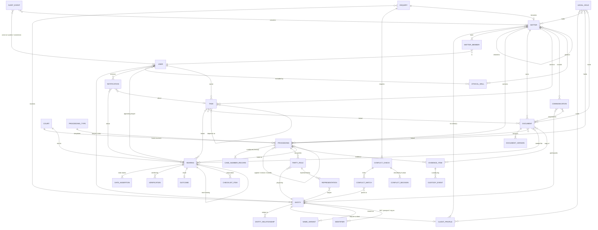
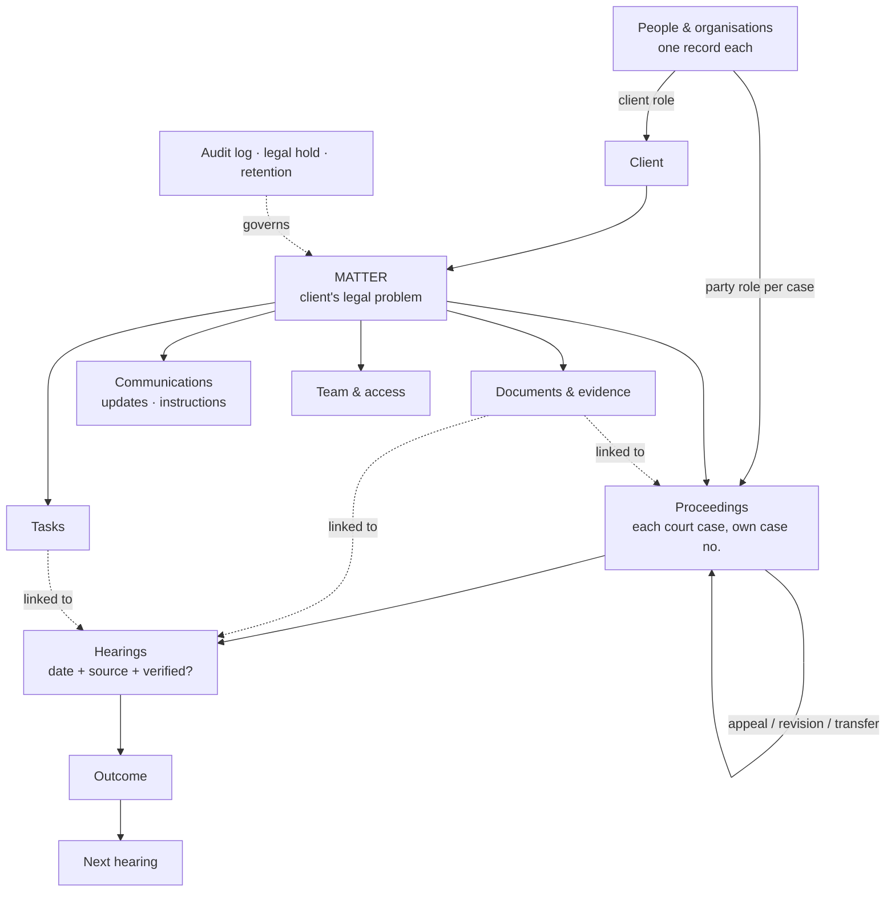
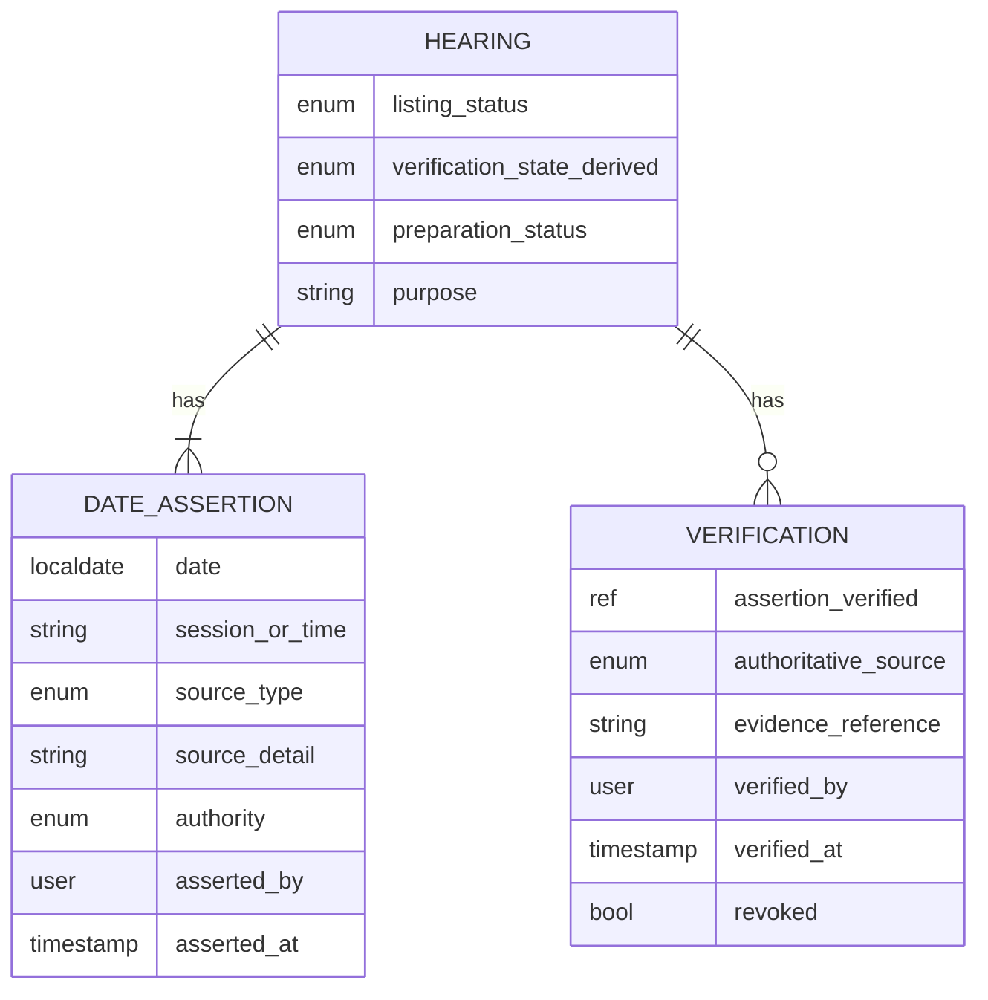

# Diagram — Information Relationships (Conceptual ERD)

Conceptual only. Names are domain concepts, not table names. Attributes shown are illustrative key attributes.

How the PART 30 entities appear below (see [doc 08](../08-information-model.md)):
**Client** = `ENTITY` + `CLIENT_PROFILE` · **Party** = `PARTY_ROLE` · **Lawyer** = `USER` (firm lawyer, also an `ENTITY`) or an `ENTITY` in a `REPRESENTATION` (opposing or external counsel) · **Evidence** = `EVIDENCE_ITEM` · **Audit event** = `AUDIT_EVENT` · **Legal hold** = `LEGAL_HOLD`. Matter, Proceeding, Court, Hearing, Document, Task, Communication and Notification appear under their own names.

## 1. Core conceptual ERD

## 2. Simplified "spine" view for non-technical review

## 3. Hearing date provenance detail

