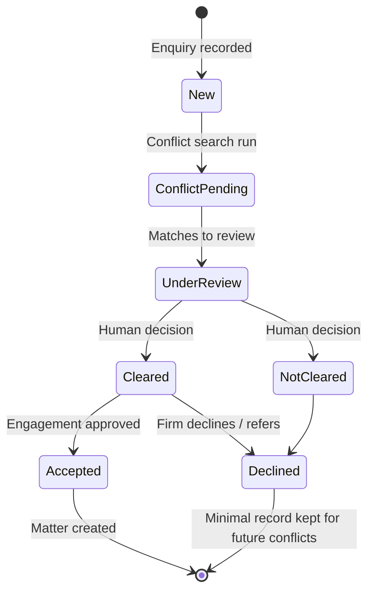
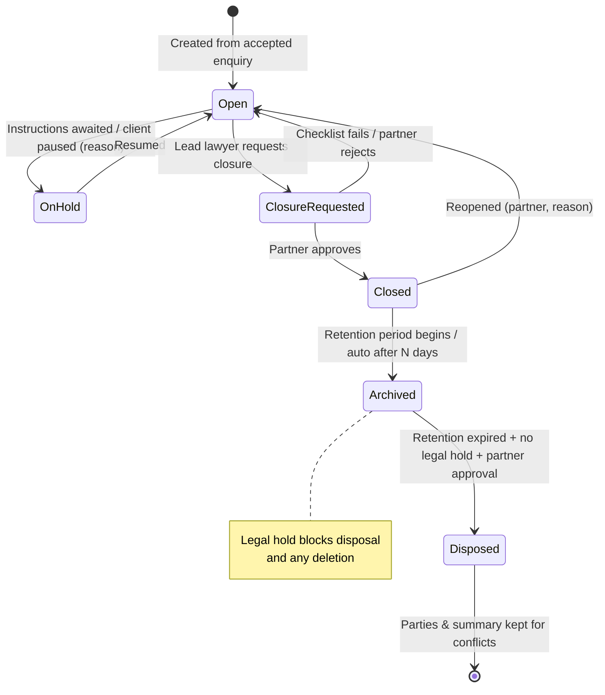
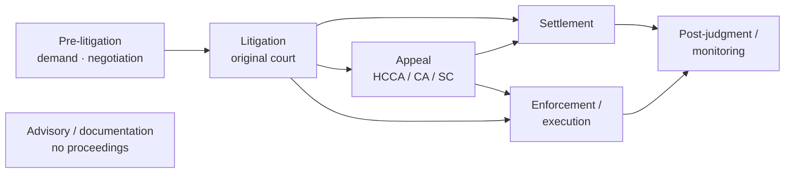
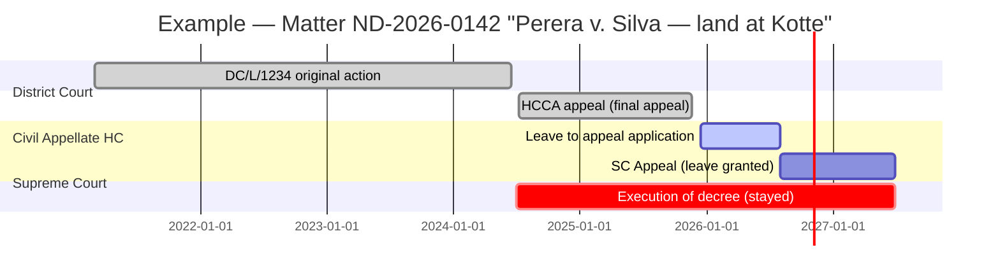

# Diagram — Matter Lifecycle

## 1. Enquiry → Matter (separate entities)

## 2. Matter lifecycle status

## 3. Phase labels (independent of lifecycle)

Phase is a configurable label; attention flags (unverified dates, overdue tasks, missing documents, inactivity) are derived automatically and never typed by users.

## 4. Matter containing multiple proceedings over time

All proceedings keep their own case numbers, parties-with-roles, hearings and documents, under one matter.
