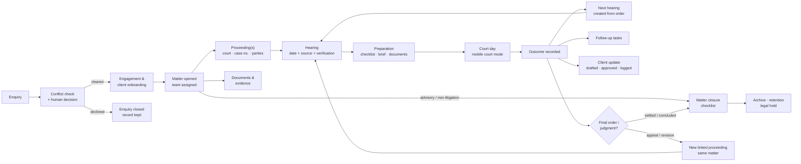
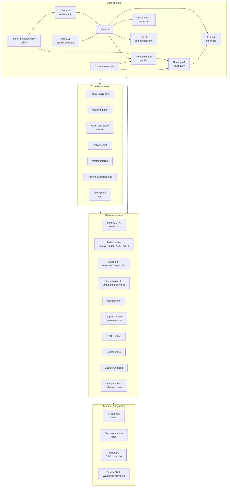
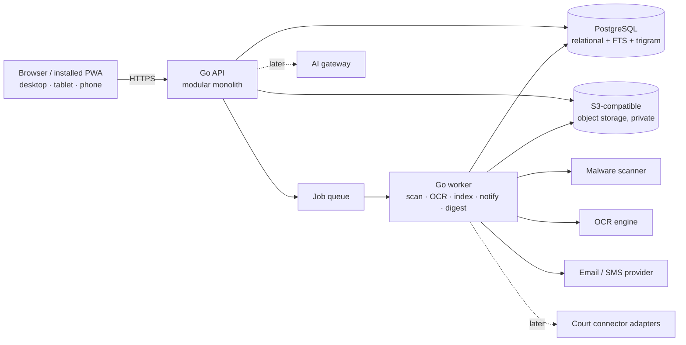

# Diagram — System Map

## 1. System-level workflow (the operating loop)

## 2. Module map

## 3. Deployment view (direction, not final)

Legend: solid = MVP; dashed = later phase. See [08-information-model.md](../08-information-model.md) and the summary's architecture section.
