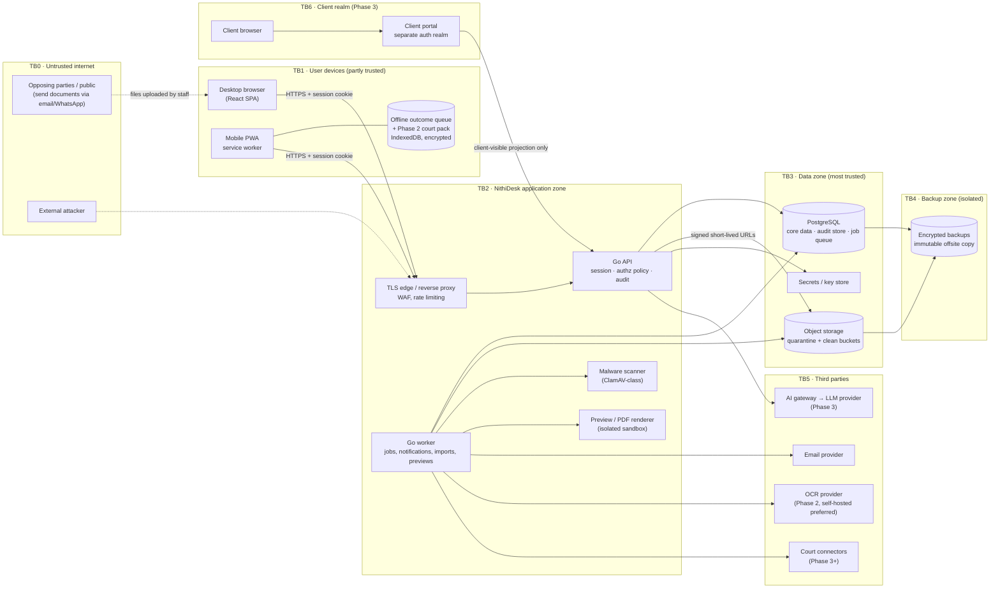

# NithiDesk — Threat Model (Phase 0)

> Status: **DRAFT v0.1**, Phase 0 deliverable for issue #28. It is a review document, not an implementation.
> Inputs: docs 08 (information model), 09 (roles and permissions), 10 (security plan), 12 (mobile and offline), 14 (AI), 15 (government integration), 16 (migration), and summary §11 (architecture direction).
> Markers: **[NEEDS LAWYER CONFIRMATION]** · **[MAKE CONFIGURABLE]** · **[ASSUMPTION]** · **[DECISION REQUIRED]**.
> Method: STRIDE per component and per data flow, plus targeted abuse cases. Likelihood and impact are each rated H/M/L. Doc 10 §2 contains the earlier actor summary; this document replaces it as the detailed reference.

---

## 1. Scope and assumptions

| # | Assumption |
|---|---|
| A1 | Architecture as in summary §11: a Go modular monolith (API binary plus worker binary), PostgreSQL, S3-compatible object storage, and a React PWA. It is deployed single-tenant, but every record carries a firm ID. **[ASSUMPTION]** until ADRs #17–#24 are approved |
| A2 | Hosting is undecided (Sri Lanka or regional cloud, issue #12). The model assumes a cloud or VPS operator that we trust under contract but who still has physical and hypervisor access **[DECISION REQUIRED]** |
| A3 | MVP clients are internal staff only. External counsel accounts and break-glass arrive in Phase 2, the client portal and AI in Phase 3, and court connectors in Phase 3+ (doc 17). Those components are modelled now so the trust boundaries are drawn correctly from the start |
| A4 | Staff use a mix of firm and personal Android phones. Phones are sometimes shared or handed to a clerk in court **[NEEDS LAWYER CONFIRMATION]** (issue #8, Q7) |
| A5 | Email is sent through a third-party provider (SMTP or API). There is no SMS or WhatsApp in MVP (doc 13 §6) |

Out of scope for this version: physical security of the firm's office, the security of personal email accounts, and court systems themselves.

---

## 2. System context and trust boundaries

| Boundary | Crossing | Why it matters |
|---|---|---|
| TB0→TB2 | Every request | Authentication, rate limiting, input validation |
| TB1↔TB2 | Session cookie, API calls, signed file URLs | Session theft, CSRF, IDOR, replay of the offline queue |
| TB1 internal | Data at rest on the phone | Device loss; a shared device |
| TB2→TB3 | SQL, object reads and writes | Authorisation must be applied *inside* queries (doc 09 §8) |
| TB2→TB5 | Outbound data to vendors | Data minimisation, processor contracts (PDPA), prompt injection back in |
| TB3→TB4 | Backup streams | Bulk exfiltration of everything at once |
| TB6→TB2 | Client portal requests | A separate realm, never the internal session model |

---

## 3. Assets ranked by sensitivity

| Rank | Asset | Why | Where |
|---|---|---|---|
| 1 | **Privileged-internal and Highly restricted documents and notes** (strategy, advice, evidence) | Breach destroys privilege and the client's case; causes professional-conduct exposure | Object storage, PG (notes), previews, OCR text, AI context |
| 2 | **Hearing dates and outcomes** (integrity) | A silently changed date can lose a case; this is the product's highest business risk (R1) | PG hearing assertions, the offline queue |
| 3 | **Ethical-wall configuration and matter ACLs** | Tampering silently opens every other asset | PG |
| 4 | **Identity of clients and parties** (names in both scripts, NIC/passport, addresses, phone numbers), including the *existence* of a matter | PDPA personal data. The mere existence of a matter against a named person can be sensitive (criminal, family, PEP) | PG, search indexes, notifications, emails |
| 5 | **Conflict search records and decisions** | Reveal prospective clients and the firm's relationships | PG |
| 6 | **Audit log** | Evidence for investigations; also a leak channel (§5.3) | PG audit store, exports |
| 7 | Credentials, MFA secrets, session tokens, signing and encryption keys | Keys to everything else | PG (hashed), KMS, browser cookies |
| 8 | Backups | Contain assets 1–7 together | Backup zone |
| 9 | Reference data and configuration (courts, templates) | Integrity: a wrong case-number pattern or court mapping causes mis-filing | PG |
| 10 | Availability of the diary on court mornings | Outage at 08:30 means lawyers go to court blind | Whole system; printable brief is the fallback (doc 17 §6) |

---

## 4. Threat actors

| Actor | Motivation | Capability | Most likely route |
|---|---|---|---|
| **External attacker** | Ransom, data theft, resale; targeted theft for an opponent | Phishing, credential stuffing, exploits of exposed services | Phishing a clerk or junior → session; vulnerable upload/preview renderer; exposed admin or database ports |
| **Curious insider** | Gossip (celebrity divorce, politician's case) | Valid account, legitimate access to some matters | Search and autocomplete, diary-wide clerk scope, reports |
| **Malicious insider / departing employee** | Takes clients and files to a new firm; sells information | Valid account, knows the processes | Bulk downloads, exports, screenshots, offline packs |
| **Ethically walled lawyer** | May not intend harm; may be pressured by a former client | Valid account, *denied* on specific matters | Side channels: search counts, autocomplete, diary placeholders, audit views, notifications, AI answers |
| **Opposing party or their agents** | Learn strategy, dates, witnesses; disrupt the case | Social engineering, sending weaponised documents, bribing staff | Phone calls to clerks; malicious PDFs that the firm uploads; insider recruitment |
| **Lost or stolen phone** | Opportunistic or targeted theft at court | Physical device, possibly unlocked | Open PWA session, offline queue or court pack |
| **Compromised vendor** (hosting, email, OCR, AI, dependencies) | Supply-chain attack, insider at the vendor | Access to infrastructure or the data stream | Hypervisor/console access, email contents, malicious library update |
| **Coerced staff member** | Threats, bribery; political pressure in high-profile matters **[NEEDS LAWYER CONFIRMATION]** on how common this is | Valid account, under pressure | Reads or changes a specific matter, alters a date, deletes a document |
| **Privileged administrator** (IT contractor, sysadmin) | Curiosity, coercion, error | Infrastructure and user administration | Grants self access, reads the database directly, disables audit, restores a backup elsewhere |

---

## 5. STRIDE analysis

Ratings: L = likelihood, I = impact (H/M/L). "Planned" refers to existing planning docs; "Gap" is what those docs do not yet cover.

### 5.1 Per component

| ID | Component | STRIDE | Threat | L | I | Planned control | Gap | Recommended control |
|---|---|---|---|---|---|---|---|---|
| C-01 | Auth (API) | S | Credential stuffing or phishing gives access to a lawyer's account | H | H | TOTP MFA mandatory, breached-password check, lockout (doc 10 §3) | TOTP is phishable through a real-time proxy | Passkeys/WebAuthn as the default in Phase 2; alert on new device + new IP; show last-login on screen |
| C-02 | Auth (API) | S | MFA reset abused through social engineering ("I lost my phone, I'm in court") | M | H | Admin-assisted reset with identity check (doc 10 §3) | No defined verification standard | Reset requires a second person (partner) to confirm in person or by callback to a number on file; user is notified on all channels; 24h cooling-off before access to Restricted matters **[MAKE CONFIGURABLE]** |
| C-03 | Sessions | S/E | Session cookie stolen (XSS, malware, shared court device) | M | H | Server sessions, HttpOnly/Secure/SameSite, idle timeout, device list (doc 10 §4) | No binding of a session to a device | Rotate session ID on login and privilege change; bind to a device key (WebAuthn/PWA key) in Phase 2; strict CSP with no inline script |
| C-04 | Authorisation policy | E/I | A new endpoint, report or job forgets the matter filter (IDOR, BOLA) | H | H | Central policy, deny by default, matter filter in every query (doc 09 §8) | Enforcement relies on developer discipline | Data access only through a repository layer that *requires* a principal; lint rule banning raw queries outside it; generated authorisation test matrix per endpoint; Postgres row-level security as a second net **[DECISION REQUIRED]** in ADR #17 |
| C-05 | Authorisation policy | T/E | Cached permission sets stay valid after a wall is created or a user removed | M | H | Invalidate on change (doc 09 §8) | No defined maximum staleness | Permission version number per user checked on every request; no caching of wall decisions beyond the request |
| C-06 | Hearing records | T/R | Date changed with no trace, or by someone who later denies it | M | H | Date assertions with source, append-only audit of date events (doc 06 §3, doc 10 §9.2) | Direct DB edits by an administrator bypass the application | Hearing assertions are insert-only (no UPDATE grant for the app role); audit hash chain; daily job compares current dates with the assertion history and alerts on mismatches |
| C-07 | Upload pipeline | T/E | Weaponised file exploits the preview renderer or scanner | M | H | Quarantine, magic-byte check, AV scan, isolated preview (doc 10 §7) | Isolation level not defined | Renderer runs in a separate container with no network, a read-only filesystem, a non-root user, seccomp and CPU/memory/time limits; outputs only images or sanitised PDF |
| C-08 | Object storage | I | Bucket misconfiguration or guessable keys expose documents | L | H | Private buckets, random keys, signed URLs (doc 07 §6) | URL lifetime not defined | Signed URLs ≤ 60 s, single-object, bound to the method; `Content-Disposition: attachment` for non-preview types; separate quarantine and clean buckets; block public ACLs at account level |
| C-09 | Worker / job queue | E/I | A job runs with system privileges and leaks data across matters (for example a notification or digest) | M | H | — | Jobs are not yet in the authorisation model | Every job carries the principal it acts for; notifications and digests are rendered by calling the same policy as the UI (doc 13) |
| C-10 | PostgreSQL | I/T | Direct database access by an engineer or administrator | M | H | JIT access, separate admin accounts (doc 10 §13) | No technical enforcement | No standing DB credentials for people; access through a break-glass bastion with session recording; app role without DDL; audit store owned by a different role |
| C-11 | Audit store | T/R | An attacker or administrator deletes or edits audit records | L | H | Append-only, hash chain, fail-closed (doc 10 §9) | Chain anchor location not defined | Periodically publish the chain head to write-once storage outside the main account (object lock); alert on verification failure |
| C-12 | Search / indexes | I | Search returns snippets, counts or names from inaccessible matters | H | H | Permission-aware search (doc 07 §8.3) | Counts and autocomplete not explicitly covered | §6.1 below |
| C-13 | Mobile PWA / offline queue | I/T | Lost phone exposes queued outcomes or court pack; queue tampered with | M | H | Encrypted storage, expiry, wipe on logout or revocation (doc 12 §5) | Queue integrity not covered | §6.5 below |
| C-14 | Email provider | I | Notification emails contain client names, case details or dates and sit in personal inboxes | H | M | No confidential content in logs (doc 10 §6) | Email content rules not defined | Emails carry a link and a neutral subject ("1 hearing needs verification"), no client or party names by default **[MAKE CONFIGURABLE]**; SPF/DKIM/DMARC on the sending domain |
| C-15 | Import tooling | T | Malicious or wrong CSV injects bad dates or formulas (CSV injection on re-export) | M | H | Dry-run, validation, manual verification of near dates (doc 16 §4) | Formula injection | Escape leading `= + - @` on every spreadsheet export; imports are only new records with their own provenance ("Imported, unverified") |
| C-16 | Admin console | E | Administrator grants themselves matter access | M | H | Admins have no matter access; dual control for permission changes (doc 10 §13) | — | §6.8 below |
| C-17 | AI gateway (Phase 3) | I/E | Prompt injection in an opposing party's document makes the model reveal other matters or take actions | M | H | AI acts as the user, permission-filtered context, no autonomous actions (doc 14 §3–4) | Injection not named | Context built only from documents the user can see in *this* matter; no tools with write effect; outputs shown as suggestions; strip hidden text and instructions from extracted content |
| C-18 | Court connectors (Phase 3+) | S/T | A spoofed or compromised feed changes hearing dates | L | H | Integration inbox, human acceptance, mapping (doc 15 §3) | — | Connector input is a date *assertion* with source "connector" and is never auto-verified; mutual TLS or signed payloads where offered |
| C-19 | Client portal (Phase 3) | E/I | Client sees internal notes or another client's matter | M | H | Separate realm, client-visible flags (doc 09 §2) | — | Portal reads from a *projection* containing only client-visible items, never the internal tables directly |
| C-20 | Backups | I | Backup copy stolen or restored elsewhere | L | H | Encryption with separate keys, dual approval, immutable copy (doc 10 §14) | — | §6.7 below |
| C-21 | Whole system | D | Outage or ransomware on a court morning | M | H | Backups, restore drills, printable brief (docs 10, 17) | No offline fallback before the PWA court pack | Scheduled email/PDF of the next two days' diary to partners and clerks each evening (already MVP as a report) and stored outside the main system |

### 5.2 Per data flow

| ID | Data flow | STRIDE | Threat | L | I | Planned control | Gap | Recommended control |
|---|---|---|---|---|---|---|---|---|
| F-01 | Browser → API (all requests) | T/I | CSRF on state-changing requests | L | H | SameSite + anti-CSRF tokens (doc 10 §4) | — | Also require a custom header on JSON APIs; reject `text/plain` content types |
| F-02 | Browser → API (upload) | T | Oversized or zip-bomb upload ties up the worker (DoS) | M | M | Size allow-list (doc 10 §7) | Archive handling not defined | Do not expand archives server-side in MVP; per-user upload quota and rate limits |
| F-03 | API → browser (document download) | I | Download link forwarded or reused | M | H | Signed short-lived URLs | — | One-time URLs; audit every issue *and* redemption; watermark Restricted downloads with the user and time |
| F-04 | PWA offline queue → API (sync) | T/R | Queue replayed or edited to post a false outcome or date | L | H | — | Not covered | §6.5 below |
| F-05 | Worker → email provider | I | Confidential detail in mail; misdirected email | H | M | — | Not covered | See C-14; send only to verified internal addresses in MVP |
| F-06 | API → AI gateway → LLM (Phase 3) | I | Data retained or used for training by the provider | M | H | Zero-retention contracts, no training (doc 14 §4) | — | Gateway strips identifiers not needed for the task; region pinning; PDPA processor agreement |
| F-07 | Connector → integration inbox (Phase 3+) | S/T | Forged update | L | H | Integration inbox (doc 15 §3.2) | — | See C-18 |
| F-08 | DB/object storage → backup | I | Interception or exfiltration of the backup stream | L | H | Encrypted backups (doc 10 §14) | — | Client-side encryption before upload; backup credentials can write but not read or delete |
| F-09 | Migration sources → import (doc 16) | I | Spreadsheets with client data left on laptops and shared drives after import | H | M | Data protection during migration (doc 16 §6) | Cleanup not enforced | Migration staging area with an expiry date; sign-off checklist confirming source copies are archived or deleted |
| F-10 | Admin console → policy store | T/E | Permission changes without second approval | M | H | Dual control (doc 10 §13) | — | Two-person rule enforced in code, not configuration, for walls and Highly restricted membership |

---

## 6. Abuse cases

Each abuse case lists the attack, why it works if nothing is done, and the controls required.

### 6.1 Authorisation bypass through secondary read paths
**Attack:** A user without access to Matter X finds it through global search, a "cases by court" report, a notification digest, an export, an iCal feed, or (Phase 3) an AI answer.
**Why it works:** These paths are often built later than the main matter page and query the database directly.
**Controls:**
- One accessible-matter set computed by the policy and joined into *every* query: search, reports, exports, digests, calendar feeds and the AI retrieval (doc 09 §8).
- A test suite that creates a walled matter and asserts it is invisible in every endpoint and job output. This is an **M1 merge gate** (§9, R-03).
- Totals in reports are computed only over accessible matters. No "123 results (5 hidden)" messages.

### 6.2 Ethical-wall leakage through side channels
**Attack:** A walled lawyer learns that the firm acts for their former client's opponent, through:
- autocomplete suggesting a client or party name,
- search result counts,
- a diary placeholder ("Restricted matter, DC Colombo 10:00") that reveals court and time,
- the audit log or "recently viewed" lists,
- conflict-check detail views,
- notifications about shared tasks.

**Controls:**
- Autocomplete draws from the same accessible set; there is no global name dictionary.
- Diary placeholders for walled users show only "Busy" with no court, case number or title **[MAKE CONFIGURABLE]** (doc 09 §5).
- Security audit views for administrators show matter IDs only (doc 09 §6). Business audit trails are visible to the matter's partner and the managing partner, never to a walled user.
- Conflict search results show the walled matter only to approvers, as "possible match — refer to managing partner".
- Every denied access attempt on a walled matter is logged and alerted (doc 09 §5).

### 6.3 IDOR on document URLs and object IDs
**Attack:** A user changes a document ID in an API call, or reuses a signed storage URL obtained earlier or from a colleague.
**Controls:**
- Object IDs are random (UUIDv7 or random), but authorisation is still checked on every request.
- Signed URLs are issued only after a policy check, with a lifetime of 60 s or less, single use where the store supports it, and audited at issue.
- Previews and thumbnails use the same check as the original; the preview image has no separate public path.

### 6.4 Malicious uploads
**Attack:** An opposing party's "affidavit" is a polyglot PDF/HTML, a PDF with JavaScript, a macro-enabled DOCX, an SVG with script, or an archive bomb. Staff upload it, and it exploits the renderer or a colleague's browser.
**Controls:**
- Allow-list of types with magic-byte verification. SVG and HTML are never rendered inline.
- AV scan in quarantine; nothing reaches the clean bucket without passing.
- Macro-enabled Office formats blocked or quarantined for manual release by a partner.
- PDFs are re-rendered to a sanitised preview in an isolated renderer (C-07).
- Downloads are served with `Content-Type` from the verified type, `X-Content-Type-Options: nosniff`, `Content-Disposition: attachment`, and from a separate origin from the app, so a crafted file cannot run script in the app's origin.

### 6.5 Tampering with or replaying the offline queue
**Attack:** On a stolen or shared phone, someone edits the IndexedDB queue to record a false next date, or replays an old "outcome recorded" item after the date was corrected.
**Controls:**
- Each queued item carries a client-generated idempotency key, the hearing's version number at capture time, and a timestamp. The server rejects duplicates and flags version mismatches as conflicts for manual resolution (doc 12 §5.2).
- Items are encrypted and bound to the session key. The server only accepts them from the same user within a maximum age, for example 72 hours **[MAKE CONFIGURABLE]**.
- A synced outcome creates a date assertion with source "court (lawyer present)" and state **Unverified**, so the clerk verification queue is the second line of defence (doc 06 §4.3).
- The server records both capture time and sync time.

### 6.6 Session theft on shared court devices
**Attack:** A lawyer logs in on a colleague's or clerk's phone, or a shared office desktop, and leaves the session open.
**Controls:**
- Short mobile idle timeout (15 min) with PIN re-unlock; absolute 12-hour lifetime (doc 10 §4).
- A "this is a shared device" login option: no PIN unlock, no offline queue, session ends on tab close.
- Visible active-device list with one-tap revoke; new-device notification by email.
- **[NEEDS LAWYER CONFIRMATION]** on how often devices are shared (issue #8, Q7).

### 6.7 Backup exfiltration
**Attack:** A backup is copied by an operator, a compromised CI credential, or the hosting provider, and restored elsewhere.
**Controls:**
- Backups are encrypted client-side with keys held separately from the backup storage (doc 10 §14).
- Backup credentials can write but not read or delete. Restores need two named people and alert the managing partner.
- An immutable offsite copy with object lock.
- Restore drills use an isolated environment and are destroyed afterwards.
- Backups are never used as test or development data; development uses synthetic data only.

### 6.8 Administrator abuse
**Attack:** The system administrator adds themselves to a matter, removes an ethical wall, reads the database directly, or turns off audit logging.
**Controls:**
- Admins have no matter access by default (doc 09 §2).
- Matter-membership changes for Restricted and Highly restricted matters, and every wall change, need partner approval enforced in code (F-10).
- Audit writes cannot be disabled through configuration, and audit failure blocks sensitive actions (doc 10 §9.3).
- No standing database credentials (C-10).
- Admin actions are summarised in a weekly report to the managing partner.

### 6.9 Hearing date changed without trace
**Attack:** A coerced clerk or a compromised account changes the next date of a hearing so the firm misses it, then reverts it.
**Controls:**
- Dates are never edited in place. Each change is a new assertion with source, actor and reason, and the previous value stays visible (doc 06 §3).
- Changes to dates inside the next 14 days notify the assigned lawyer and the clerk immediately (doc 13).
- A "recently changed dates" panel appears on the clerk and partner dashboards.
- A nightly integrity job recomputes current dates from assertions and alerts on any difference (C-06).

---

## 7. OWASP ASVS 5.0 mapping

**Recommendation:** target **ASVS 5.0 Level 2** across the application, with **Level 3 controls for authorisation (V8), logging (V16) and file handling (V5)**, because those protect assets 1–3. Chapter numbers follow ASVS 5.0.0. Confirm the exact requirement IDs when the security requirements are written. **[ASSUMPTION]**

| ASVS 5.0 chapter | Level | NithiDesk focus | Threats |
|---|---|---|---|
| V1 Encoding and Sanitization | L2 | Output encoding; Sinhala Unicode normalisation that doesn't open homoglyph tricks | 6.4 |
| V2 Validation and Business Logic | L2 | Hearing-date rules, outcome → next-hearing rule, import validation | C-06, C-15 |
| V3 Web Frontend Security | L2 | CSP with no inline script; separate download origin; no secrets in the SPA | C-03, 6.4 |
| V4 API and Web Service | L2 | Content-type checks, CSRF header, rate limits | F-01 |
| V5 File Handling | **L3** | Type verification, AV, isolated rendering, safe download headers | C-07, 6.4 |
| V6 Authentication | L2 (L3 for passkeys in Phase 2) | MFA for all users, reset process | C-01, C-02 |
| V7 Session Management | L2 | Rotation, idle and absolute timeouts, device list, revocation | C-03, 6.6 |
| V8 Authorization | **L3** | Central policy, data-level filtering, walls, dual control | C-04, C-05, 6.1, 6.2, 6.8 |
| V9 Self-contained Tokens | n/a in MVP | Applies if signed URLs or JWTs are adopted | C-08 |
| V10 OAuth and OIDC | Phase 2 | Entra ID / Google SSO | — |
| V11 Cryptography | L2 | Field-level encryption for NIC/passport; key management | Asset 4, 7 |
| V12 Secure Communication | L2 | TLS 1.2+/1.3, HSTS, internal TLS between zones | TB boundaries |
| V13 Configuration | L2 | Secrets out of Git; hardened containers; no debug in prod | C-10 |
| V14 Data Protection | L2 | Minimisation, masking, client-side storage limits, email content rules | C-13, C-14 |
| V15 Secure Coding and Architecture | L2 | Dependency scanning, repository layer that enforces authorisation | C-04 |
| V16 Security Logging and Error Handling | **L3** | Append-only, hash-chained audit, fail-closed, no confidential data in logs | C-11, 6.9 |

---

## 8. PDPA No. 9 of 2022 considerations

The legal reading of every row is **[NEEDS LAWYER CONFIRMATION]**. Doc 10 §6.1 contains the design consequences; this table adds the threat-model view.

| Topic | Threat-model consequence |
|---|---|
| Controller and processor roles | The firm is the controller; the host, email, OCR and AI providers are processors. Each crossing of TB5 needs a processor agreement and a data-minimisation decision |
| Personal-data breach | The audit log must be able to answer "which data subjects and matters did this account or this backup expose?" within hours. Design audit events to include matter ID and record IDs (not content), so impact assessment is a query, not a forensic project |
| Breach notification to the Data Protection Authority and data subjects | Timelines come from the Act and its regulations **[NEEDS LAWYER CONFIRMATION]**. The incident runbook (doc 10 §16) needs named owners, including the DPO |
| Special categories (criminal, health, children) | Matters in these areas default to Restricted (doc 09 §3) and are excluded from offline packs and AI by default |
| Cross-border transfer | Hosting and every TB5 vendor outside Sri Lanka depend on the transfer rules; this is an input to issue #12 and ADR #19 **[DECISION REQUIRED]** |
| Data-subject rights vs privilege | Access requests by an opposing party may target data the firm holds about them. Responses need a human legal decision, and the audit log of the request itself must not be visible to the requester |
| Retention | Logs and backups hold personal data for as long as they are kept; retention periods must be set and enforced, including expiry of backup copies (doc 10 §14) |

---

## 9. Security requirements M1 must satisfy (prioritised)

**Headline: M1 must prove that no read path can show a matter to someone who isn't allowed to see it, and that no hearing date can change without a trace.**

| # | Requirement | Threats addressed | Test ideas |
|---|---|---|---|
| R-01 | All data access goes through a repository layer that requires an authenticated principal; queries outside it fail a lint or build check | C-04, 6.1 | Static check in CI that rejects `pgx` calls outside the repository package; unit test that a call without a principal panics or errors |
| R-02 | Central policy combining role capability, matter ACL, record restriction and ethical wall, deny by default (doc 09 §1) | C-04, 6.2 | Table-driven tests over role × confidentiality × wall; property test: adding a wall never increases visible matters |
| R-03 | **Walled-matter invisibility suite**: one fixture matter that a test user is walled from must be absent from every endpoint, search, autocomplete, report, notification, export and daily-brief PDF | 6.1, 6.2, C-09, C-12 | Generated test per registered route; snapshot test of digest emails and PDFs for that user; merge gate |
| R-04 | Hearing date assertions are insert-only; current date derived from them; every change carries source, actor and reason | C-06, 6.9 | Attempt UPDATE as the app role (must fail); integrity job detects an injected mismatch |
| R-05 | Append-only audit store owned by a separate role, with hash chaining; sensitive actions fail closed if the audit write fails | C-11, 6.8 | Kill the audit write in a test → download returns an error; verify the chain detects a deleted row |
| R-06 | TOTP MFA mandatory for every account; argon2id passwords; breached-password check; progressive lockout | C-01 | Login without MFA is impossible; brute-force test triggers lockout and alert |
| R-07 | Server-side sessions: rotation on login and privilege change, idle (30 min desktop / 15 min mobile) and absolute (12 h) timeouts, device list, immediate revocation on user disable | C-03, 6.6 | Disable a user → next request 401 on all devices; session fixation test |
| R-08 | CSRF protection and strict CSP (no inline script), separate download origin, safe download headers | F-01, 6.4 | Automated header checks; CSRF test without token/header |
| R-09 | Upload pipeline with quarantine, magic-byte check, AV scan, and preview rendering in an isolated container without network | C-07, 6.4 | Upload EICAR, a polyglot PDF/HTML, a macro DOCX and an SVG with script; all are blocked or neutralised |
| R-10 | Signed URLs ≤ 60 s, issued only after a policy check, audited | C-08, 6.3 | Reuse after expiry fails; another user's URL is refused at issue |
| R-11 | Offline outcome queue: encrypted, session-bound, idempotency key + hearing version, maximum age, synced outcomes always Unverified | 6.5 | Replay the same item twice → one record; stale version → conflict; item older than max age → rejected |
| R-12 | Administrators have no matter access; wall changes and Highly restricted membership need a second approver, enforced in code | 6.8, F-10 | Admin role reading a matter gets 403; a single-approver wall change stays pending |
| R-13 | No confidential content (document text, full NIC, tokens) in application logs or notification emails by default | C-14, F-05 | Log-scanning test with seeded NIC and client names; email snapshot test |
| R-14 | Encrypted, separated backups with a restore test before go-live; no production data in development | C-20, 6.7 | Documented restore drill; CI check that seed data is synthetic |
| R-15 | Spreadsheet exports escape formula characters; imports create Unverified assertions with provenance "import" | C-15 | Export a party named `=HYPERLINK(...)` and confirm it is escaped |

Requirements R-01 to R-05 are the hardest to add later and must be in place before any matter data, even test data, is loaded.

---

## 10. Open items

| Item | Marker | Tracked in |
|---|---|---|
| How often are phones shared or handed to clerks in court? | [NEEDS LAWYER CONFIRMATION] | #8 (Q7) |
| Do any staff ever need access to matters without being on the team (beyond break-glass)? | [NEEDS LAWYER CONFIRMATION] | #9 (Q8) |
| Does the firm want any exception to ethical walls for the managing partner? | [NEEDS LAWYER CONFIRMATION] | doc 09 §1 |
| Hosting location and the threat posed by the hosting operator | [DECISION REQUIRED] | #12, ADR #19 |
| Postgres row-level security as a second enforcement layer | [DECISION REQUIRED] | ADR #17 |
| Default content of notification emails (names or no names) | [MAKE CONFIGURABLE] | doc 13 §5 |
| PDPA breach-notification timelines and which provisions are in force at go-live | [NEEDS LAWYER CONFIRMATION] | #11 (Q10) |

Review this threat model at each milestone gate (G1–G3, doc 18 §4) and whenever a new TB5 vendor or a Phase 2/3 component is added.
