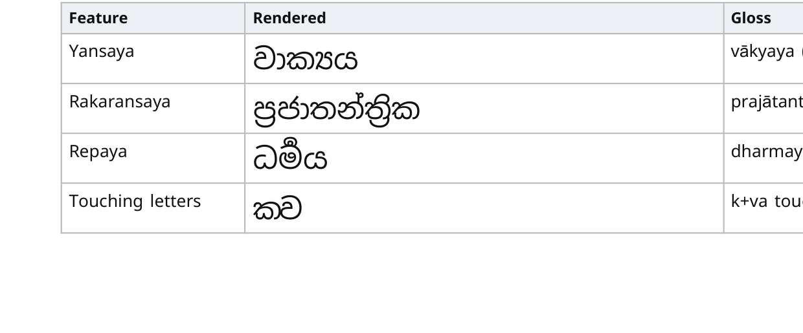
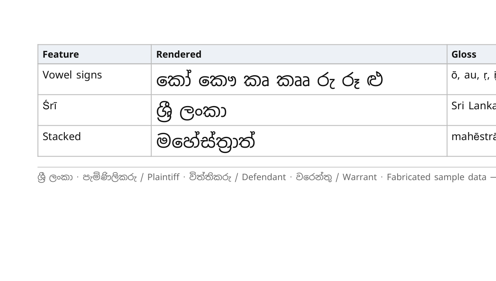

# Spike #26 — Bilingual PDF rendering

> Status: **complete** (2026-10-13). Feeds **ADR #23** (PDF generation with correct Sinhala shaping).
> Code: [`spikes/bilingual-pdf/`](../../spikes/bilingual-pdf/README.md) (throwaway, Gate G0).
> Markers: **[ASSUMPTION]** · **[NOT TESTED]** = reasoning only, not measured in this spike.

## 1. Question

Can NithiDesk produce a printable **bilingual Sinhala/English daily brief** (doc 17 §6, M1) whose Sinhala is shaped correctly, and which approach should ADR #23 adopt?

## 2. Setup

| Item | Value |
|---|---|
| Page | A4, print CSS, fictitious firm, 6 fabricated hearings across DC, MC, HC, Primary Court, CA, SC. The Sinhala court names, party names, purposes and verification states sit beside their English equivalents. |
| Shaping stress strings | Yansaya `වාක්‍යය`, rakaransaya `ප්‍රජාතන්ත්‍රික`, repaya `ධර්‍මය`, touching letters `ක‍්ව`, vowel signs `කෝ කෞ කෘ කෲ රු රූ ළු`, `ශ්‍රී ලංකා`, stacked `මහේස්ත්‍රාත්`. Strings are built with explicit ZWJ (U+200D) per SLS 1134: C + ් + ZWJ + C for yansaya/rakaransaya/repaya, and C + ZWJ + ් + C for touching letters. |
| Fonts | Noto Sans Sinhala **variable** (v2.006); Noto Serif Sinhala **variable** (v2.007); Noto Sans Sinhala **static** Regular + Bold; **Nirmala UI** (the Windows system Sinhala font). All Noto fonts were loaded via `@font-face`. |
| Engines | Headless Chrome and headless Edge on Windows 11 (`--headless --print-to-pdf --no-pdf-header-footer`) |
| Checks | Visual check of rasterised pages; font embedding type (PyMuPDF); text extraction of 9 probe strings with **MuPDF** and **pypdf**, with whitespace normalised |

**Iskoola Pota** was not tested because it isn't installed on this Windows 11 machine. Current Windows ships **Nirmala UI** for Sinhala, so Nirmala UI was the system-font comparison.

## 3. Results

| Font × engine | Shaping correct? | Embedded as | File size (2 pages) | Text extraction, MuPDF | Text extraction, pypdf |
|---|---|---|---|---|---|
| Noto Sans **static** · Chrome | ✅ all strings | TrueType (Type0) subsets, names kept | **105 KB** | 8/9 (stacked string gets a duplicated `ා`) | 0/9 |
| Noto Sans **static** · Edge | ✅ identical | same | 105 KB | 8/9 | 0/9 |
| Noto Sans **variable** · Chrome | ✅ all strings | **Type 3** (glyph drawings, no font name) | 453 KB | 9/9 | 3/9 |
| Noto Sans **variable** · Edge | ✅ identical | same | 453 KB | 9/9 | 3/9 |
| Noto Serif **variable** · Chrome | ✅ all strings | Type 3 | 484 KB | 9/9 | 3/9 |
| Noto Serif **variable** · Edge | ✅ identical | same | 484 KB | 9/9 | 3/9 |
| Nirmala UI (system) · Chrome | ✅ readable; touching letters fall back to a visible al-lakuna (`ක්ව`) | TrueType (Type0) | 115 KB | 7/9 (stacked and touching strings get duplicated marks) | 4/9 |
| Nirmala UI (system) · Edge | same | same | 115 KB | 7/9 | 4/9 |

Crops of the shaping-test table (static Noto Sans, Chrome):

The same crops for Nirmala UI: [part 1](img/stress-nirmala-system-chrome-p1.png) · [part 2](img/stress-nirmala-system-chrome-p2.png).

### Findings

1. **Chromium shapes Sinhala correctly** with every font tested. Conjuncts, repaya, the ශ්‍රී ligature, pre-base vowel reordering (`ෙ`, `ො`) and stacked clusters are all right. Chrome and Edge give the same result because both use Chromium/Skia/HarfBuzz.
2. **Use static fonts, not variable fonts.** Chrome embeds variable-font glyphs as **Type 3** drawings. That makes files about 4× larger, drops the font name, and gives poorer text extraction in simple readers. Static Regular and Bold files embed as normal TrueType subsets.
3. **Don't rely on system fonts.** Nirmala UI only exists on Windows, and Iskoola Pota is older still and not always installed. Nirmala also lacks the touching-letter ligature. A Linux server container has neither font, so the server must **bundle its fonts** and reference them explicitly.
4. **Text copied out of the PDF depends on the reader, and is imperfect.** MuPDF recovered 8–9 of 9 strings, while pypdf recovered 0–4. Some ligatures map back with duplicated marks. The ZWJ survives in MuPDF output. **Implications:**
   - Generated PDFs are for **printing and sharing only**.
   - Search and indexing must use NithiDesk's source data, never text extracted from its own PDFs.
   - Copy/paste in Acrobat or a browser PDF viewer, and tagged/accessible PDF, are **[NOT TESTED]**.
5. **Latin text fell back to Arial and Times New Roman** because the Noto Sinhala fonts contain only a minimal Latin set. Production should also bundle **Noto Sans (Latin)** so English renders the same in every environment.
6. Two pages held 6 hearings plus the test table. A real day with 15–25 hearings needs a denser print layout. That's a design task for M1, not a technical risk.

## 4. Go-native PDF libraries — [NOT TESTED]

Go wasn't installed on the spike machine, so this section is reasoning only.

- **`jung-kurt/gofpdf`** (archived), **`go-pdf/fpdf`**, **`signintech/gopdf`** and **`johnfercher/maroto`** (built on gofpdf) map code points straight to glyphs and do **no OpenType shaping**: no GSUB/GPOS and no reordering. Sinhala would come out wrong. Pre-base vowel signs would be in the wrong place, and conjuncts, repaya and ශ්‍රී would show as separate letters with visible al-lakuna. **Not suitable.**
- A pure-Go route does exist in principle. **`go-text/typesetting`**, a Go port of HarfBuzz used by Gio, can shape the text, and a PDF writer would then place glyph IDs and write a ToUnicode map. That means building and maintaining our own text-layout engine: line breaking, tables and pagination. **Not justified** for MVP.
- **wkhtmltopdf** uses an old QtWebKit and was archived in 2023. **Avoid.**
- **WeasyPrint** (Python, shapes through Pango/HarfBuzz) would probably shape Sinhala correctly **[NOT TESTED]**. It would add a Python runtime for no clear gain over Chromium.

## 5. Recommendation for ADR #23

**Render PDFs from server-side HTML templates with headless Chromium**, run as an isolated service that the worker calls.

| Decision point | Recommendation |
|---|---|
| Rendering engine | Headless Chromium. Either drive it from Go with **chromedp**, or run a ready-made HTTP wrapper such as **Gotenberg** as a sidecar container **[NOT TESTED]**. Choose in the ADR based on operational preference. |
| Templates | Go `html/template` (auto-escaping) with print CSS. The same templates can later serve the client portal and other exports. |
| Fonts | Bundle **static** Noto Sans Sinhala Regular + Bold and Noto Sans Latin (OFL) with the renderer. Load them via `@font-face`, never from system fonts. Pin font versions and test rendering whenever they change. |
| Where it runs | In the **worker** (asynchronous PDF jobs), never in the API request path. Set a render timeout and a concurrency limit. |
| Security | Disable JavaScript; **block all network access** from the renderer, since templates must embed fonts and images rather than fetch them; run sandboxed as an unprivileged user; escape all data through `html/template`. Treat the renderer as handling confidential data, so no logging of page content. |
| Deployment cost | Chromium adds about 300–400 MB to a container image and noticeable memory per render **[ASSUMPTION]**. Acceptable for a single-firm deployment. Measure during M1. |
| Regression testing | Keep the stress strings from this spike as **golden tests**: render to PDF, rasterise, compare against approved images. Also check that text extraction (MuPDF) contains the probe strings, to catch font or engine regressions. |
| Data rule | Generated PDFs are outputs only. Never index or re-import them. |

The PDF-shaping part of risk **R19** (Sinhala rendering/search defects, doc 19) is **reduced to low** for the Chromium approach. It stays open until the same templates are confirmed to render identically **inside the Linux production container** (an M1 task).

## 6. Not covered

- Rendering inside a Linux container, and physical printing.
- Copy/paste fidelity in Acrobat and browser PDF viewers; tagged/accessible PDF and PDF/A.
- Legacy non-Unicode Sinhala fonts (FM-Abhaya and similar). These are an input and migration problem (doc 11, doc 16), not an output one.
- Tamil shaping. This spike's approach should cover it; confirm in a future Tamil spike.
